# 00 — Подготовка рабочего места

[← На главную](../../README.md) | [↑ Карта курса](../README.md) | [Лабораторная работа №1 →](../01-blink/README.md)

---

# Добро пожаловать в STM32 Start Lab

Этот раздел предназначен для студентов, которые раньше **никогда не работали со STM32**.

Не требуется заранее знать:

- STM32CubeMX;
- STM32CubeIDE;
- HAL;
- GPIO;
- ST-LINK;
- SWD;
- структуру STM32-проекта.

На этом этапе необходимо только подготовить оборудование и рабочую среду.

После выполнения раздела компьютер и оборудование должны быть готовы к первой лабораторной работе.

---

# Что будет сделано

В ходе подготовки вы:

1. подготовите необходимое оборудование;
2. познакомитесь с Blue Pill;
3. познакомитесь с ST-LINK V2;
4. скачаете необходимое программное обеспечение;
5. установите STM32CubeMX;
6. локально установите STM32CubeF1;
7. установите STM32CubeIDE;
8. подготовите рабочую папку;
9. отключите ненужные автоматические обновления;
10. проверите готовность рабочего места;
11. перейдёте к лабораторной работе №1.

---

# Важно

Этот раздел является **подготовительным**.

Это ещё не лабораторная работа №1.

Первая лабораторная начинается после завершения подготовки:

➡️ **[Лабораторная работа №1 — Blink](../01-blink/README.md)**

---

# 1. Что потребуется

Для первой лабораторной работы необходим минимальный комплект.

## Обязательно

- Blue Pill;
- микроконтроллер STM32F103C8T6;
- ST-LINK V2;
- 4 соединительных провода Dupont;
- USB-кабель для ST-LINK;
- компьютер с Windows.

## Не требуется для первой работы

На первом занятии не нужны:

- макетная плата;
- внешний светодиод;
- резисторы;
- логический анализатор;
- дополнительные датчики;
- внешние кнопки.

Они могут потребоваться в следующих лабораторных работах.

---

# 2. Blue Pill

В текущем учебном треке используется:

```text
Blue Pill
STM32F103C8T6
```

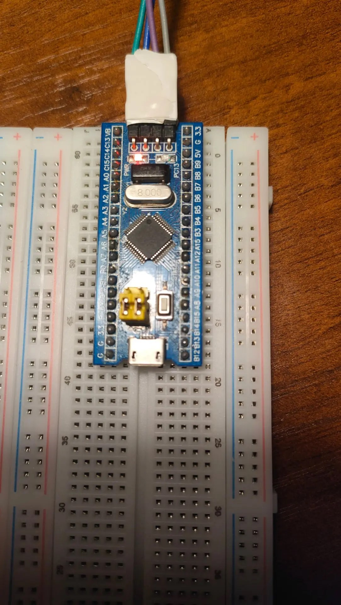

Blue Pill — компактная плата на микроконтроллере STM32.

В рамках курса она используется как основной учебный стенд.

---

## Что необходимо проверить при покупке

На микроконтроллере должна быть маркировка:

```text
STM32F103C8T6
```

Для текущего курса важно приобрести именно плату на STM32F103C8T6, так как:

- инструкции создаются для этого микроконтроллера;
- используется пакет STM32CubeF1;
- первый проект настроен под STM32F103C8T6;
- примеры курса проверяются на этой конфигурации.

Подробная информация:

➡️ **[Blue Pill STM32F103C8T6](../../resources/hardware/blue-pill-stm32f103/README.md)**

---

# 3. ST-LINK V2

Для программирования микроконтроллера используется:

```text
ST-LINK V2
```


ST-LINK позволяет:

- записывать программу во Flash-память STM32;
- запускать программу;
- выполнять отладку;
- работать с микроконтроллером через интерфейс SWD.

Для первой лабораторной работы достаточно обычного ST-LINK V2.

---

# 4. Как Blue Pill и ST-LINK используются вместе

Плата и программатор выглядят примерно так:


Для интерфейса SWD используются четыре основных сигнала:

| ST-LINK V2 | Blue Pill |
|---|---|
| 3.3V | 3.3V |
| GND | GND |
| SWDIO | SWDIO |
| SWCLK | SWCLK |

Подробное подключение будет выполнено в лабораторной работе №1.

---

## Важно

Перед подключением необходимо ориентироваться **по маркировке контактов**, а не только по расположению выводов.

У разных исполнений ST-LINK V2 расположение контактов может отличаться.

Не подключайте вывод:

```text
5V
```

программатора к контакту:

```text
3.3V
```

платы.

---

# 5. Что необходимо скачать

Для первой лабораторной работы не требуется устанавливать всё программное обеспечение STM32.

Минимальный комплект состоит из трёх компонентов.

---

## 5.1. STM32CubeMX 6.18.1

Файл:

```text
SetupSTM32CubeMX-6.18.1-Win-x86_64.zip
```

STM32CubeMX используется для:

- выбора микроконтроллера;
- настройки выводов;
- настройки периферии;
- настройки SWD;
- настройки GPIO;
- генерации проекта.

---

## 5.2. STM32CubeIDE 2.2.0

Файл:

```text
stm32cubeide_2.2.0-Win-x86_64.exe.zip
```

STM32CubeIDE используется для:

- написания программы;
- редактирования исходного кода;
- компиляции;
- сборки проекта;
- работы со ST-LINK;
- прошивки STM32;
- отладки программы.

---

## 5.3. STM32CubeF1 v1.8.0

Файл:

```text
stm32cubef1.zip
```

Это локальный MCU Package для микроконтроллеров семейства STM32F1.

Для текущего курса необходим:

```text
STM32F103C8T6
```

Пакет содержит:

- HAL-драйверы;
- CMSIS;
- системные компоненты;
- файлы семейства STM32F1.

Архив `stm32cubef1.zip` перед установкой распаковывать не требуется.

---

# 6. Дополнительные файлы

В комплект также могут входить дополнительные программы.

Для первого Blink они не являются обязательными.

---

## 6.1. ST-LINK Driver

Файл:

```text
stsw-link009.zip
```

В проверенной конфигурации необходимые драйверы ST-LINK устанавливаются вместе с STM32CubeIDE.

Отдельный пакет рекомендуется использовать только в случае, если программатор не определяется системой.

---

## 6.2. STM32CubeProgrammer

Файл:

```text
SetupSTM32CubeProgrammer_win64.zip
```

STM32CubeProgrammer может использоваться для:

- диагностики ST-LINK;
- ручной прошивки;
- просмотра памяти;
- работы с Option Bytes;
- дополнительных операций с STM32.

Для лабораторной работы №1 отдельная установка STM32CubeProgrammer не требуется.

---

# 7. Служебные файлы комплекта

## VERSIONS.txt

Файл:

```text
VERSIONS.txt
```

содержит список версий программного обеспечения, с которыми проверялся курс.

Он находится в:

➡️ **[resources/software](../../resources/software/)**

---

## SHA256SUMS

Контрольные суммы находятся в:

➡️ **[resources/software/checksums](../../resources/software/checksums/)**

SHA-256 позволяет проверить, что скачанный файл:

- не повреждён;
- полностью скачан;
- соответствует подготовленному комплекту.

Для первого занятия ручная проверка SHA-256 не обязательна.

---

# 8. Где скачать файлы

Установочные файлы распространяются через раздел **Releases** репозитория.

➡️ **[Открыть Releases](/SeZuev22/stm32-start-lab/releases)**

Для первого запуска необходимо подготовить:

```text
1. SetupSTM32CubeMX-6.18.1-Win-x86_64.zip

2. stm32cubeide_2.2.0-Win-x86_64.exe.zip

3. stm32cubef1.zip
```

Остальные файлы пока можно не устанавливать.

---

# 9. Проверенная конфигурация

Весь первый учебный маршрут проверен на следующей конфигурации:

| Компонент | Версия |
|---|---|
| ОС | Windows 10 x64 |
| STM32CubeMX | 6.18.1 |
| STM32CubeIDE | 2.2.0 |
| STM32CubeF1 | 1.8.0 |
| MCU | STM32F103C8T6 |
| Плата | Blue Pill |
| Программатор | ST-LINK V2 |
| Библиотека | HAL |
| Интерфейс | SWD |

Использование именно этих версий уменьшает вероятность отличий между инструкцией и интерфейсом программ.

---

# 10. Установка STM32CubeMX

Начнём с STM32CubeMX.

Распакуйте:

```text
SetupSTM32CubeMX-6.18.1-Win-x86_64.zip
```

и запустите установщик.

---

## 10.1. Режим установки

В проверенной конфигурации рекомендуется выбрать:

```text
Install for all users
```

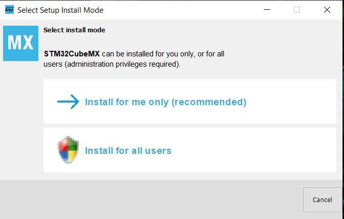

### Почему

При тестировании варианта:

```text
Install for me only
```

STM32CubeMX был установлен в пользовательский каталог Windows.

На тестовом компьютере после этого появилась проблема с запуском встроенной Java Runtime Environment.

Установка:

```text
Install for all users
```

в стандартный системный путь проблему устранила.

Это не означает, что ошибка обязательно возникнет на каждом компьютере, но для курса используется проверенный вариант.

---

# 11. Лицензионное соглашение STM32CubeMX

Ознакомьтесь с условиями лицензии.

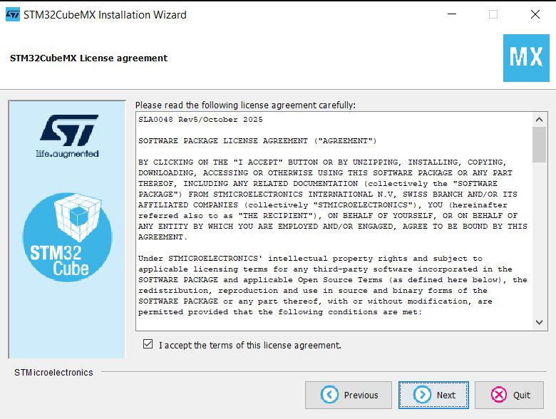

Подтвердите условия использования ST.

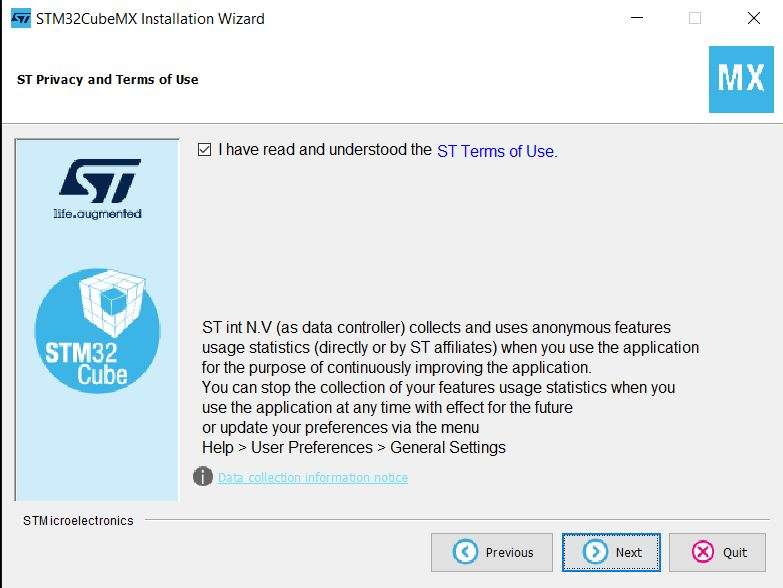

---

# 12. Путь установки STM32CubeMX

Для установки для всех пользователей используется стандартный путь:

```text
C:\Program Files\STMicroelectronics\STM32Cube\STM32CubeMX
```

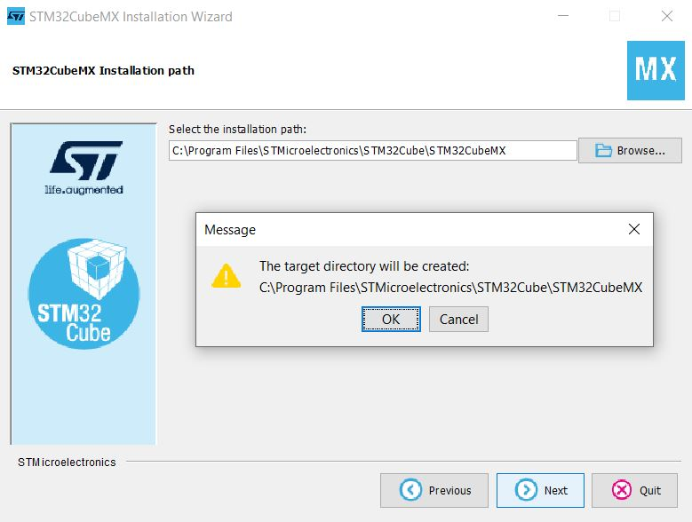

Рекомендуется не изменять путь без необходимости.

---

# 13. Ярлыки

Оставьте создание ярлыков по умолчанию.

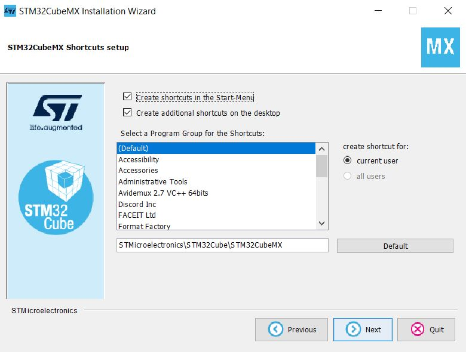

После этого начнётся установка.

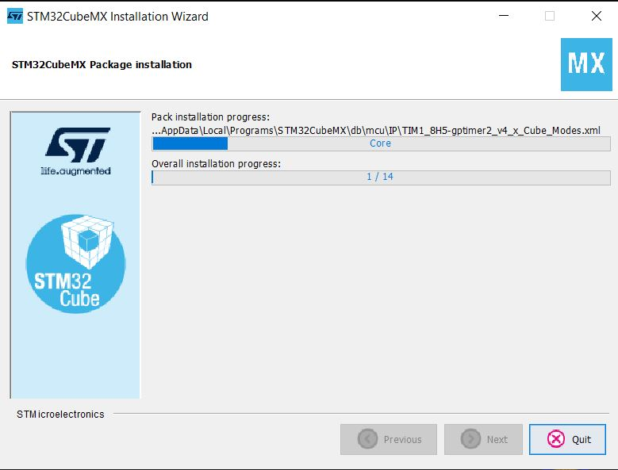

После завершения должно появиться сообщение об успешной установке.

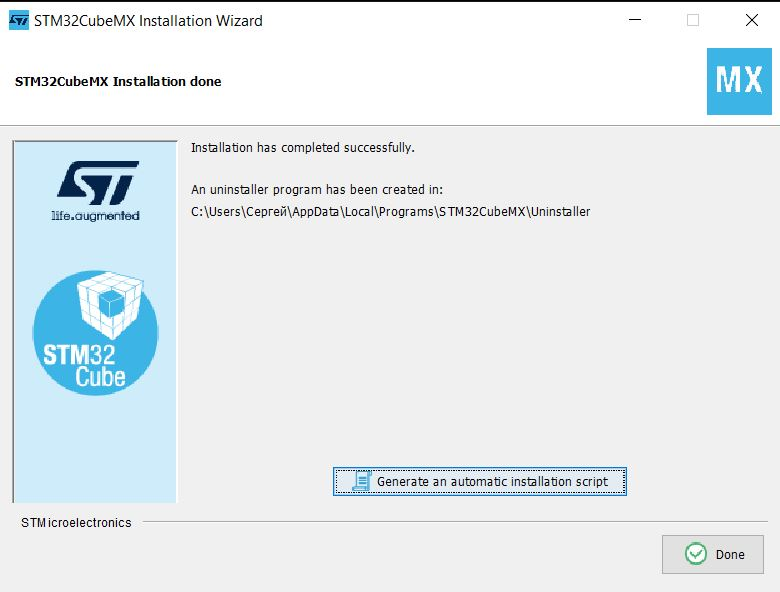

---

# 14. Первый запуск STM32CubeMX

Запустите STM32CubeMX.

Главное окно выглядит примерно так:

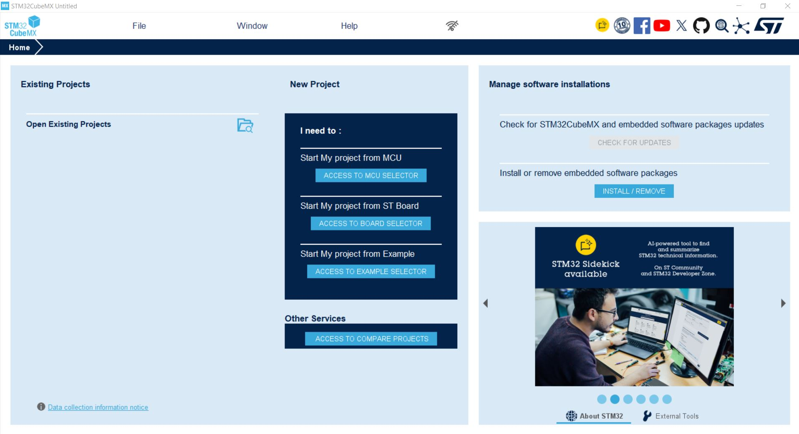

Если приложение открылось — основной этап установки CubeMX завершён.

---

# 15. Возможная ошибка Java Runtime Environment

На одном из проверенных вариантов установки появилось сообщение:

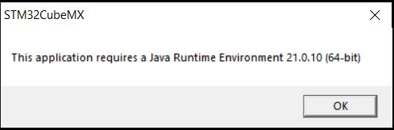

При этом встроенная Java физически присутствовала в каталоге программы.

На тестовой системе помогло:

1. удалить пользовательскую установку;
2. снова запустить установщик;
3. выбрать:
   ```text
   Install for all users
   ```
4. использовать стандартный системный путь;
5. запустить STM32CubeMX повторно.

После этого программа работала штатно.

---

# 16. Работа STM32CubeMX без постоянного доступа к интернету

При отсутствии сети STM32CubeMX может попытаться обратиться к серверам ST.

Например:

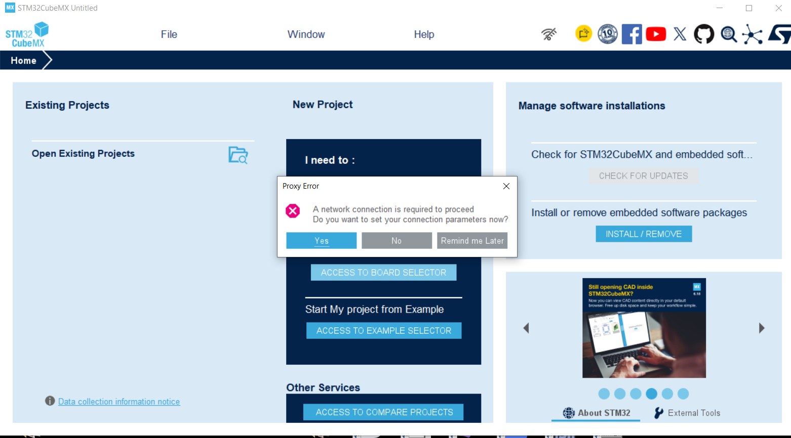

Для текущего курса это не является проблемой, если необходимый MCU Package уже подготовлен локально.

При появлении запроса на настройку Proxy можно выбрать:

```text
No
```

и продолжить работу с локальными компонентами.

---

# 17. Установка STM32CubeF1 v1.8.0

Теперь необходимо установить локальный MCU Package.

На главном экране STM32CubeMX выберите:

```text
INSTALL / REMOVE
```

Откроется:

```text
Embedded Software Packages Manager
```

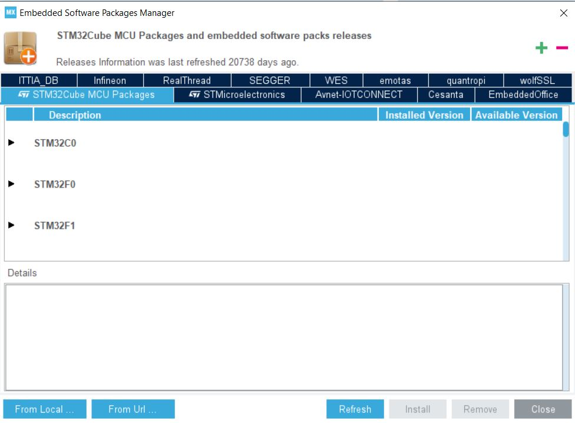

---

## 17.1. Установка из локального файла

Нажмите:

```text
From Local...
```

Выберите:

```text
stm32cubef1.zip
```

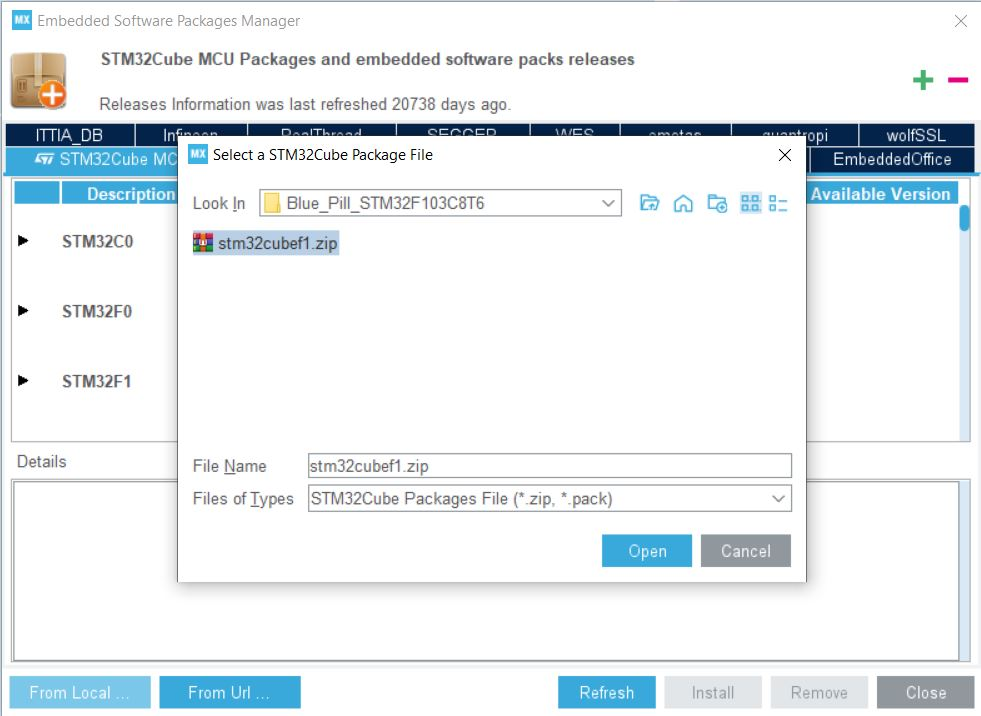

---

## 17.2. Установка пакета

STM32CubeMX проверит и установит содержимое архива.

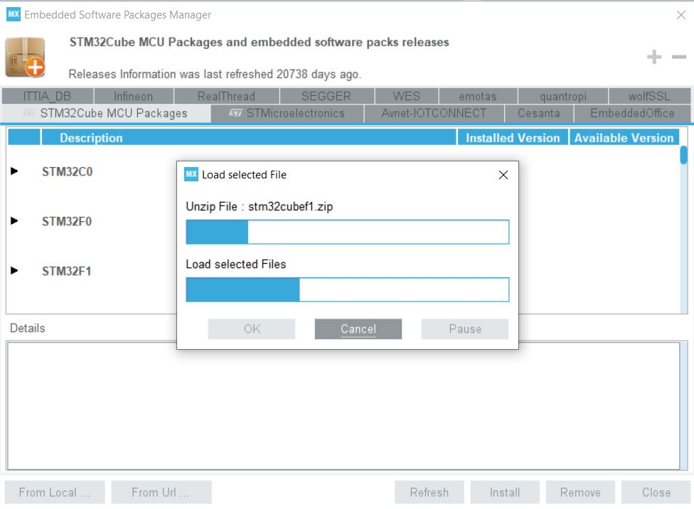

После завершения должна отображаться установленная версия:

```text
STM32CubeF1 v1.8.0
```

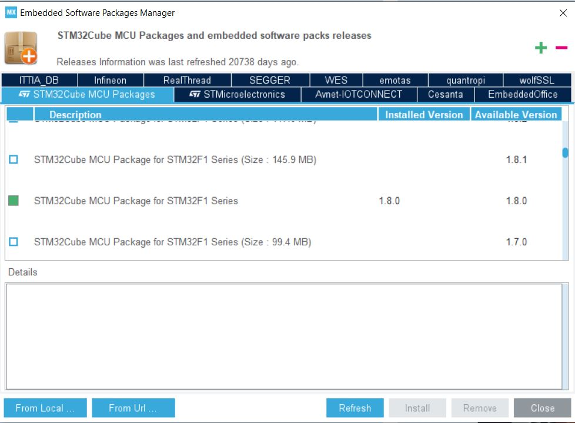

---

# 18. Installed Version и Available Version

В менеджере пакетов могут отображаться две разные версии:

```text
Installed Version
```

и:

```text
Available Version
```

Для offline-работы важно именно:

```text
Installed Version
```

В текущем курсе используется:

```text
STM32CubeF1 v1.8.0
```

Даже если STM32CubeMX знает о существовании более новой версии, автоматически скачивать её не требуется.

---

# 19. Настройка STM32CubeMX для offline-работы

Откройте:

```text
Help
→ Connection and Updates
→ Updater Settings
```

Установите:

```text
Check and Update Settings:
Manual Check
```

и:

```text
Data Auto-Refresh:
No Auto-Refresh at Application start
```

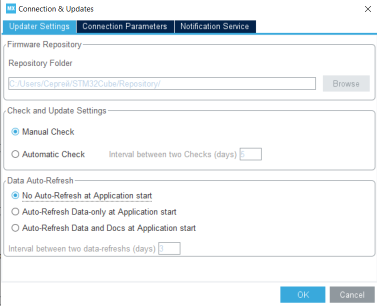

### Зачем

Это уменьшает количество автоматических сетевых запросов при запуске программы.

Обновления при необходимости можно проверять вручную.

---

# 20. Возможные сетевые ошибки STM32CubeMX

При отсутствии сети могут появляться сообщения:

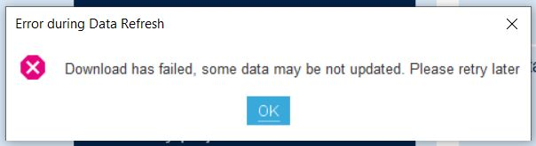

или:

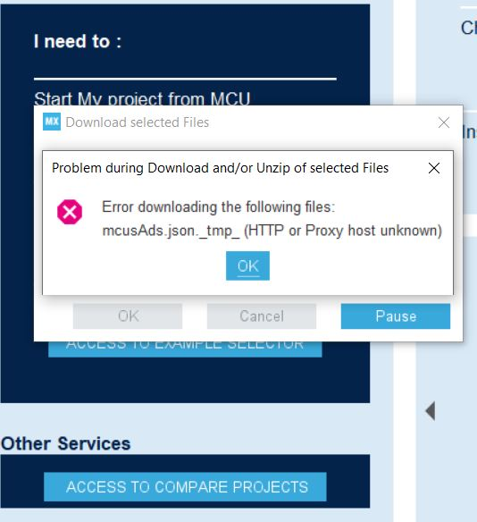

Если локальный пакет STM32CubeF1 уже установлен, эти ошибки не означают, что проект невозможно создать.

Они относятся к попыткам обновления онлайн-данных.

---

# 21. Установка STM32CubeIDE

Теперь установим среду разработки.

Распакуйте:

```text
stm32cubeide_2.2.0-Win-x86_64.exe.zip
```

---

# 22. Если появляется NSIS Error

На тестовом компьютере при запуске установщика из пользовательского каталога появилась ошибка:

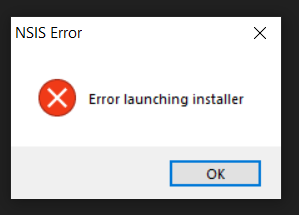

Для проверенного решения установочные файлы были полностью распакованы в короткий путь без кириллицы:

```text
C:\STM32_IDE_INSTALL
```

После этого установщик был запущен от имени администратора.

Если обычный запуск работает — выполнять дополнительные действия не требуется.

---

# 23. Запуск установщика STM32CubeIDE

После запуска появится мастер установки.

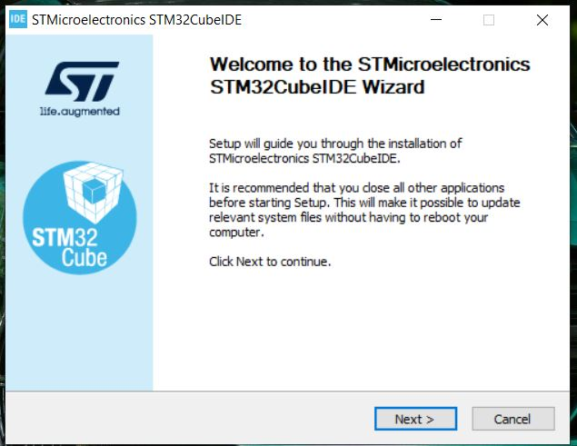

Нажмите:

```text
Next
```

---

# 24. Лицензионное соглашение

Ознакомьтесь с условиями.

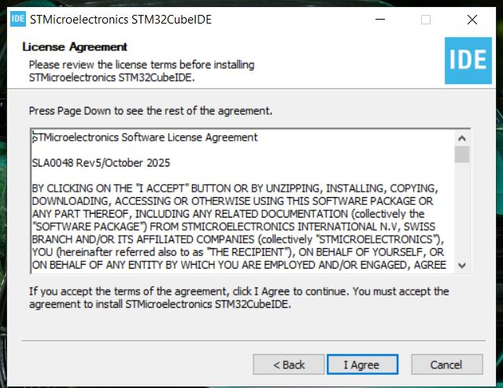

Для продолжения нажмите:

```text
I Agree
```

---

# 25. Путь установки STM32CubeIDE

На проверенном компьютере использовался путь:

```text
C:\ST\STM32CubeIDE_2.2.0
```

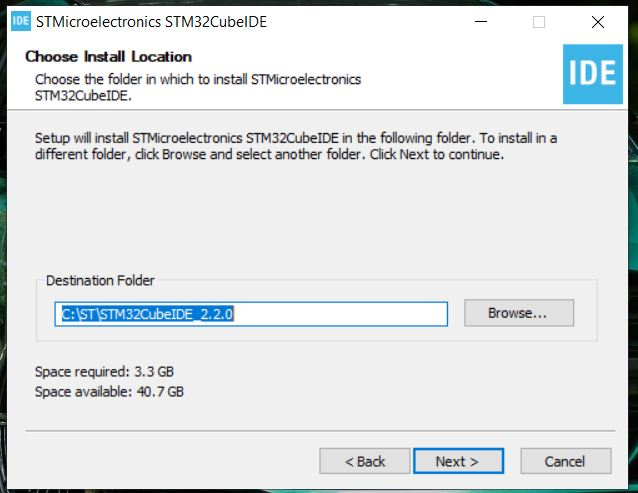

Можно оставить путь, предложенный установщиком.

---

# 26. Драйверы

В окне выбора компонентов доступны:

- SEGGER J-Link drivers;
- ST-LINK drivers.

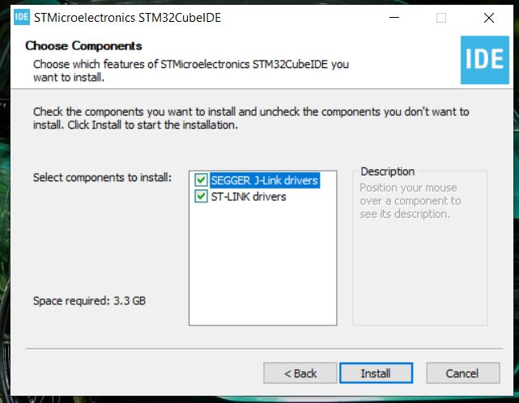

Для курса драйвер ST-LINK необходим.

На проверенной установке оба пункта были оставлены включёнными.

---

# 27. Установка STM32CubeIDE

Запустите установку.

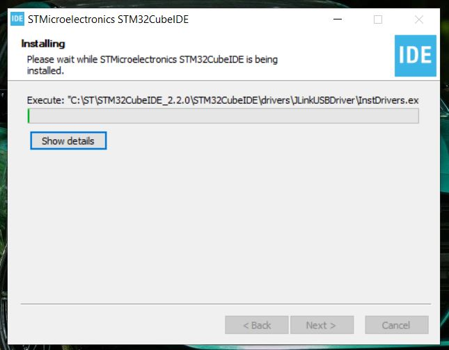

После завершения появится сообщение:

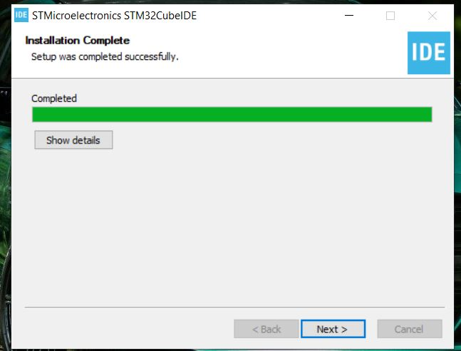

Закройте мастер:

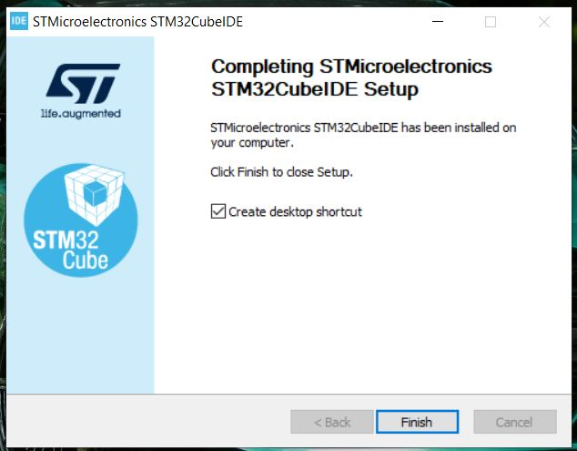

---

# 28. Рабочая папка Workspace

При первом запуске STM32CubeIDE необходимо выбрать Workspace.

Для курса рекомендуется:

```text
C:\STM32_WORKSPACE
```

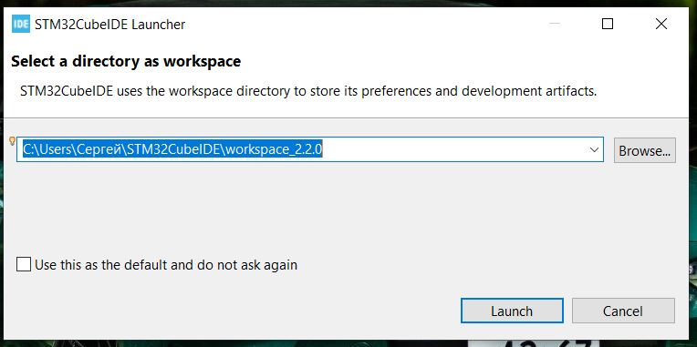

---

## Что такое Workspace

Workspace — рабочая область STM32CubeIDE.

В ней IDE хранит:

- проекты;
- служебные файлы;
- настройки рабочей среды;
- метаданные Eclipse.

Короткий путь без кириллицы удобен для учебного стенда и уменьшает вероятность проблем со сторонними инструментами.

---

# 29. Первый запуск STM32CubeIDE

После запуска откроется главное окно:

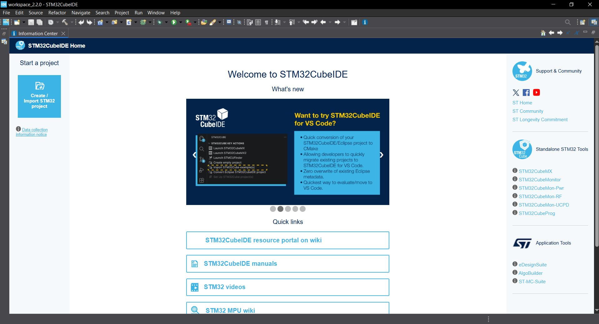

Если окно открылось без ошибок — установка среды разработки завершена.

---

# 30. Microsoft Defender

При первом запуске STM32CubeIDE может предложить исключить IDE из проверки Microsoft Defender.

Для учебной конфигурации рекомендуется сохранить стандартную проверку:

```text
Keep STM32CubeIDE being scanned by Microsoft Defender
```

Создавать исключение для первого учебного проекта не требуется.

---

# 31. Отключение автоматической проверки обновлений STM32CubeIDE

Откройте:

```text
Window
→ Preferences
→ Install/Update
→ Automatic Updates
```

Снимите:

```text
Automatically find new updates and notify me
```

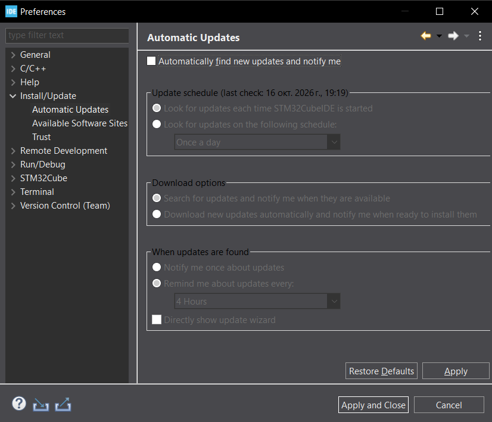

Обновления при необходимости можно выполнять вручную.

---

# 32. Available Software Sites

В настройках также существует раздел:

```text
Install/Update
→ Available Software Sites
```

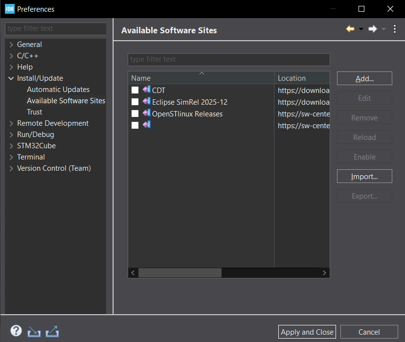

Удалять адреса репозиториев не требуется.

Для курса достаточно отключить автоматическую проверку обновлений.

---

# 33. Обновление firmware ST-LINK

При первом подключении ST-LINK STM32CubeIDE может предложить обновить его firmware.

Пример:


Для первой лабораторной работы обновление не требуется, если программатор уже:

- определяется системой;
- подключается к STM32;
- выполняет программирование.

Особенно не рекомендуется обновлять неизвестный клон ST-LINK без необходимости.

---

# 34. Официальная документация

Перед переходом к лабораторной работе полезно знать, где находится техническая документация.

Она собрана здесь:

➡️ **[Справочная документация](../../resources/references/README.md)**

Основные документы для текущего курса:

- DS5319 — STM32F103 datasheet;
- RM0008 — STM32F1 Reference Manual;
- PM0056 — Cortex-M3 Programming Manual;
- UM1850 — STM32F1 HAL/LL;
- AN2586 — Hardware Development;
- документация STM32CubeMX;
- документация STM32CubeIDE.

---

## Не нужно читать всё сразу

Студенту не требуется перед первой лабораторной читать сотни страниц документации.

В каждой работе будет указано:

```text
какой документ открыть
↓
какой раздел найти
↓
что посмотреть
↓
зачем эта информация нужна
```

---

# 35. Что пока не нужно делать

На подготовительном этапе пока **не нужно**:

- создавать проект STM32F103C8T6;
- настраивать PC13;
- писать Blink;
- изменять Clock Tree;
- компилировать программу;
- прошивать микроконтроллер.

Это выполняется в:

➡️ **[Лабораторной работе №1 — Blink](../01-blink/README.md)**

---

# 36. Проверка готовности

Перед переходом к первой лабораторной работе проверьте каждый пункт.

## Оборудование

- [ ] есть Blue Pill;
- [ ] на плате используется STM32F103C8T6;
- [ ] есть ST-LINK V2;
- [ ] есть четыре соединительных провода;
- [ ] есть USB-кабель.

## STM32CubeMX

- [ ] STM32CubeMX 6.18.1 установлен;
- [ ] STM32CubeMX запускается;
- [ ] STM32CubeF1 v1.8.0 установлен локально;
- [ ] установлен режим `Manual Check`;
- [ ] установлен `No Auto-Refresh at Application start`.

## STM32CubeIDE

- [ ] STM32CubeIDE 2.2.0 установлен;
- [ ] STM32CubeIDE запускается;
- [ ] ST-LINK drivers установлены;
- [ ] Workspace создан;
- [ ] автоматическая проверка обновлений отключена.

---

# 37. Если всё готово

Если все обязательные пункты выполнены, подготовка рабочего места завершена.

Следующий этап:

# Лабораторная работа №1

## Создание первого проекта STM32 и управление GPIO — Blink

В первой лабораторной работе вы:

- выберете STM32F103C8T6;
- включите SWD;
- настроите PC13;
- создадите проект;
- познакомитесь со структурой проекта;
- напишете программу на HAL;
- выполните Build;
- подключите ST-LINK;
- прошьёте STM32;
- получите первый физический результат.

Ожидаемый результат:

```text
5 миганий
→ пауза 2 секунды
→ повтор
```

➡️ **[Начать лабораторную работу №1 →](../01-blink/README.md)**

---

# Если возникла проблема

Не переходите к следующему этапу, пока текущий не работает.

Принцип курса:

```text
возникла проблема
↓
определить этап
↓
проверить настройку
↓
устранить проблему
↓
проверить результат
↓
продолжить
```

Это важнее, чем просто как можно быстрее получить работающий код.

---

# Итог подготовительного этапа

После прохождения раздела студент должен понимать:

- какое оборудование используется;
- какой STM32 используется;
- зачем нужен ST-LINK;
- какие программы необходимы;
- зачем нужен STM32CubeMX;
- зачем нужен STM32CubeIDE;
- что такое STM32CubeF1;
- как установить MCU Package локально;
- как подготовить offline-конфигурацию;
- где искать официальную документацию;
- куда переходить для выполнения первой лабораторной работы.

---

# Навигация

[← На главную](../../README.md)

[↑ Карта учебного курса](../README.md)

➡️ **[Лабораторная работа №1 — Blink →](../01-blink/README.md)**