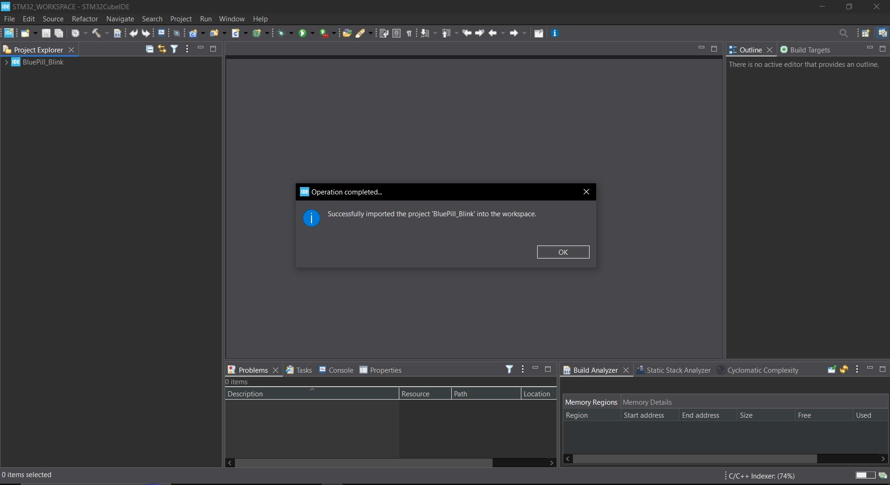
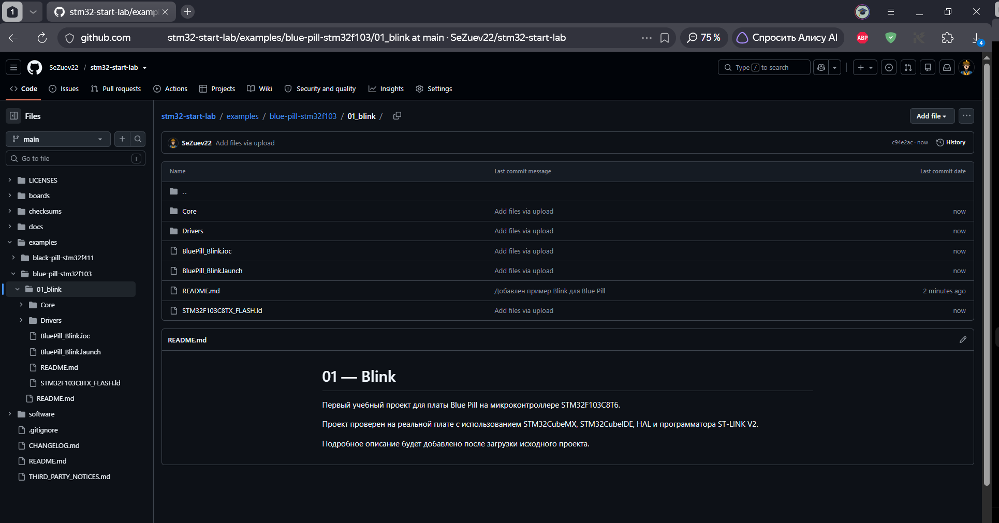
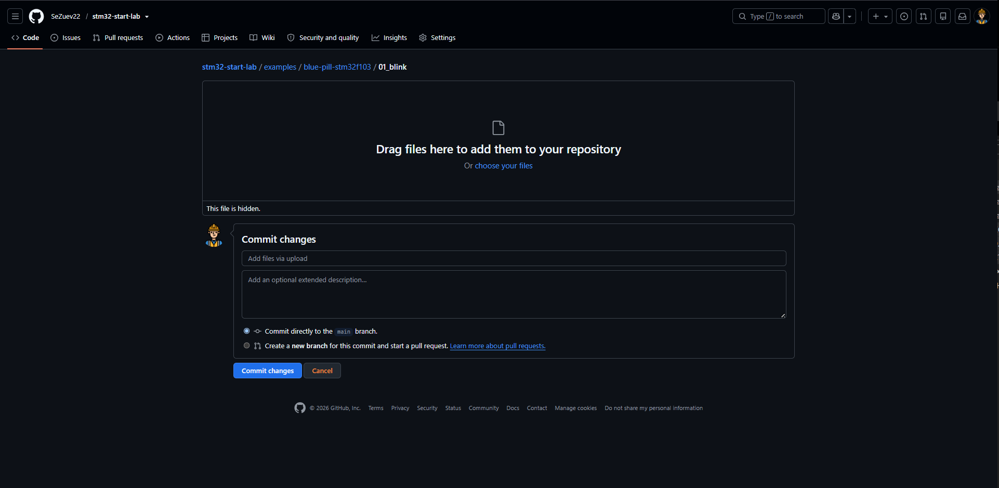

# STM32 Start Lab — Windows: от чистой установки до первого Blink

> Пошаговое учебное пособие для первого знакомства со STM32 на Windows.  
> Проверенный маршрут: **STM32CubeMX → локальный STM32CubeF1 → STM32CubeIDE → Blue Pill STM32F103C8T6 → ST-LINK V2 → программа Blink**.

---

## 1. Цель пособия

Цель этого раздела — провести начинающего пользователя через полный базовый цикл работы со STM32:

```text
подготовка программного обеспечения
        ↓
offline-установка STM32CubeMX
        ↓
локальная установка STM32CubeF1
        ↓
установка STM32CubeIDE
        ↓
создание проекта для STM32F103C8T6
        ↓
настройка SWD и GPIO
        ↓
генерация проекта
        ↓
написание программы на HAL
        ↓
сборка
        ↓
подключение ST-LINK V2
        ↓
прошивка
        ↓
проверка работы светодиода
```

Инструкция специально построена так, чтобы студент мог выполнить основной маршрут **без автоматического обращения к онлайн-репозиториям STMicroelectronics** после предварительной подготовки нужных файлов.

---

## 2. Проверенная конфигурация

| Компонент | Проверенная версия |
|---|---|
| ОС | Windows 10 x64 |
| STM32CubeMX | 6.18.1 |
| STM32CubeIDE | 2.2.0 |
| STM32CubeF1 | 1.8.0 |
| Плата | Blue Pill |
| MCU | STM32F103C8T6 |
| Библиотека | HAL |
| Программатор | ST-LINK V2 |
| Интерфейс | SWD |

> Эта инструкция фиксирует **проверенную учебную конфигурацию**. Более новые версии программ и firmware packages могут иметь отличия в интерфейсе.

---

# Часть I. Подготовка STM32CubeMX

## 3. Запуск установщика STM32CubeMX

Запустите установщик STM32CubeMX.

На первом этапе рекомендуется выбрать установку для всех пользователей:

```text
Install for all users
```


### Почему рекомендуется `Install for all users`

При тестировании варианта `Install for me only` программа установилась в пользовательский путь:

```text
C:\Users\<имя>\AppData\Local\Programs\STM32CubeMX
```

На тестовом компьютере с кириллицей в имени пользователя после такой установки появилось сообщение о невозможности найти Java Runtime Environment, хотя встроенная JRE физически присутствовала и запускалась отдельно.

Поэтому для данного пособия используется более устойчивый проверенный вариант:

```text
Install for all users
```

---

## 4. Лицензионное соглашение STM32CubeMX

Ознакомьтесь с лицензионным соглашением и примите его для продолжения установки.


Далее подтвердите условия использования ST.


---

## 5. Путь установки STM32CubeMX

При установке для всех пользователей используется системный путь:

```text
C:\Program Files\STMicroelectronics\STM32Cube\STM32CubeMX
```


Рекомендуется оставить путь, предложенный установщиком.

---

## 6. Ярлыки

Оставьте создание ярлыков по умолчанию.


После этого начнётся копирование файлов.


После завершения появится сообщение об успешной установке.


---

## 7. Первый запуск STM32CubeMX

После успешной установки запустите STM32CubeMX обычным ярлыком.


На главном экране доступны:

- создание проекта по микроконтроллеру;
- выбор официальной платы ST;
- управление embedded software packages;
- работа с существующими проектами.

Для Blue Pill в дальнейшем используется **MCU Selector**, а не Board Selector.

---

## 8. Типичная проблема: CubeMX требует JRE

При тестировании пользовательской установки было получено сообщение:


В установленной папке при этом реально присутствовала встроенная Java 21.0.10, поэтому отдельная Java для проверенного варианта установки не потребовалась.

### Что делать

Для данной проверенной конфигурации:

1. удалить неудачную пользовательскую установку;
2. запустить установщик повторно;
3. выбрать `Install for all users`;
4. оставить системный путь в `Program Files`;
5. запустить CubeMX обычным ярлыком.

После этого CubeMX на тестовом компьютере запускался штатно.

> Этот пункт относится к реально воспроизведённой проблеме на тестовой системе. Он не означает, что ошибка обязательно появится на каждом компьютере.

---

# Часть II. Offline-настройка STM32CubeMX

## 9. Сетевые сообщения при работе без интернета

При отсутствии подключения CubeMX может сообщить, что для операции требуется сеть.


Если задача выполняется с уже подготовленными локальными файлами, настройка прокси не требуется.

Нажмите:

```text
No
```

и продолжите работу с локальными компонентами.

---

## 10. Открытие менеджера MCU Packages

На главном экране STM32CubeMX нажмите:

```text
INSTALL / REMOVE
```

Откроется:

```text
Embedded Software Packages Manager
```


---

## 11. Установка STM32CubeF1 из локального ZIP

Нажмите:

```text
From Local...
```

Выберите заранее подготовленный архив:

```text
stm32cubef1.zip
```


CubeMX распакует и проверит пакет.


После завершения в поле `Installed Version` должна появиться локально установленная версия.

Для данной работы проверено:

```text
STM32CubeF1 v1.8.0
```


### Важно

STM32CubeMX официально поддерживает сценарий установки MCU Package через `From Local...`, когда доступ к интернету отсутствует.

---

# Часть III. Установка STM32CubeIDE

## 12. Возможная ошибка NSIS

При первом запуске установщика CubeIDE из длинного пользовательского пути была получена ошибка:


Для проверенной системы помог перенос установщика в короткий путь без кириллицы, например:

```text
C:\STM32_IDE_INSTALL
```

После распаковки установщик был запущен **от имени администратора**.

---

## 13. Запуск мастера установки CubeIDE

После корректного запуска появляется мастер установки.


Нажмите:

```text
Next
```

---

## 14. Лицензионное соглашение CubeIDE

Ознакомьтесь с лицензионным соглашением.


Для продолжения нажмите:

```text
I Agree
```

---

## 15. Путь установки CubeIDE

На тестовой системе установщик предложил:

```text
C:\ST\STM32CubeIDE_2.2.0
```


Рекомендуется оставить путь по умолчанию.

---

## 16. Дополнительные драйверы

В составе установки доступны:

- SEGGER J-Link drivers;
- ST-LINK drivers.

Для работы данного проекта ST-LINK driver необходим.


Для проверенного сценария оба пункта оставлены включёнными.

---

## 17. Процесс и завершение установки

После нажатия `Install` начнётся установка.


После завершения:


Затем нажмите `Finish`.


---

# Часть IV. Workspace и offline-настройка CubeIDE

## 18. Workspace

При первом запуске CubeIDE предлагает выбрать рабочую папку.

Для учебного проекта рекомендуется короткий путь без кириллицы:

```text
C:\STM32_WORKSPACE
```


### Что такое Workspace

Workspace — рабочая область STM32CubeIDE. В ней IDE хранит:

- проекты;
- внутренние настройки рабочего пространства;
- метаданные Eclipse;
- информацию о текущей сессии.

Служебную папку:

```text
.metadata
```

не нужно переносить в GitHub.

---

## 19. Главное окно STM32CubeIDE

После запуска откроется рабочее окно IDE.


---

## 20. Отключение автоматической проверки обновлений CubeIDE

Откройте:

```text
Window
→ Preferences
→ Install/Update
→ Automatic Updates
```

Снимите флажок:

```text
Automatically find new updates and notify me
```


Это убирает автоматическую проверку новых версий при обычной работе.

Раздел:

```text
Available Software Sites
```

содержит источники программных обновлений Eclipse/STM32CubeIDE.


Для базового учебного сценария удалять эти адреса не требуется.

---

## 21. Offline-настройка STM32CubeMX

В CubeMX откройте:

```text
Help
→ Connection and Updates
→ Updater Settings
```

Выберите:

```text
Manual Check
```

и:

```text
No Auto-Refresh at Application start
```


Таким образом обновления остаются доступными вручную, но программа не должна автоматически запрашивать их при каждом запуске.

---

# Часть V. Создание проекта Blue Pill

## 22. Почему выбирается MCU, а не плата

Blue Pill — сторонняя плата на STM32F103C8T6.

Поэтому используем:

```text
ACCESS TO MCU SELECTOR
```

и выбираем конкретный микроконтроллер.

---

## 23. Выбор STM32F103C8T6

В `MCU/MPU Selector` введите:

```text
STM32F103C8T6
```


Выберите соответствующий вариант и нажмите:

```text
Start Project
```

---

## 24. Настройка Serial Wire

Откройте:

```text
System Core
→ SYS
```

В поле:

```text
Debug
```

выберите:

```text
Serial Wire
```


### Зачем это делается

Интерфейс SWD используется ST-LINK для:

- программирования Flash;
- запуска программы;
- отладки.

При включении SWD используются:

```text
PA13 → SWDIO
PA14 → SWCLK
```

---

## 25. Настройка PC13

На схеме микроконтроллера нажмите вывод:

```text
PC13
```

Выберите:

```text
GPIO_Output
```


Затем задайте пользовательскую метку:

```text
LED
```

Для проверенной Blue Pill начальный уровень установлен:

```text
High
```


### Почему PC13

На используемой в эксперименте Blue Pill встроенный пользовательский LED подключён к PC13.

На этой плате светодиод работает как **active-low**:

```text
логический 0 → LED включён
логическая 1 → LED выключен
```

Поэтому начальное значение `High` оставляет LED выключенным при старте.

> Разводка сторонних клонов может отличаться. Перед использованием другого экземпляра платы следует проверить его маркировку и схему.

---

# Часть VI. Настройка проекта и локального firmware package

## 26. Project Manager

Перейдите в:

```text
Project Manager
```

Задайте:

```text
Project Name: BluePill_Blink
Project Location: C:\STM32_WORKSPACE
Toolchain / IDE: STM32CubeIDE
```

---

## 27. Важная настройка STM32CubeF1

При подключении к интернету CubeMX может знать о более новой версии STM32CubeF1 и автоматически выбрать её.

Если локально установлена версия `1.8.0`, снимите:

```text
Use latest available version
```

и выберите:

```text
STM32Cube FW_F1 V1.8.0
```


### Почему это важно

Если оставить более новую, но отсутствующую локально версию, CubeMX предложит её скачать.

Пример такого сообщения:


При полностью offline-сценарии скачивание невозможно.

Поэтому версия проекта должна соответствовать локально установленному пакету.

---

## 28. Генерация проекта

Нажмите:

```text
GENERATE CODE
```

При правильной настройке CubeMX сообщит об успешной генерации.


Нажмите:

```text
Open Project
```

---

# Часть VII. Проект в STM32CubeIDE

## 29. Импорт проекта

После открытия CubeIDE проект будет импортирован в Workspace.



---

## 30. Структура проекта

В `Project Explorer` появятся основные элементы.


### `Core/Inc`

Заголовочные файлы приложения.

### `Core/Src`

Исходные `.c`-файлы приложения.

Главный файл:

```text
Core/Src/main.c
```

### `Drivers/CMSIS`

Базовые определения Arm Cortex-M и STM32.

### `Drivers/STM32F1xx_HAL_Driver`

Библиотека HAL для STM32F1.

### `BluePill_Blink.ioc`

Конфигурация STM32CubeMX.

### `STM32F103C8TX_FLASH.ld`

Linker Script — описание размещения программы и данных в памяти микроконтроллера.

---

# Часть VIII. Первая программа

## 31. Где писать пользовательский код

В `main.c` CubeMX создаёт специальные области:

```c
/* USER CODE BEGIN ... */

/* USER CODE END ... */
```

Код пользователя следует размещать внутри них.

Это важно, потому что при повторной генерации проекта CubeMX сохраняет содержимое `USER CODE`-областей.

---

## 32. Программа: 5 миганий и пауза 2 секунды

Внутри бесконечного цикла `while (1)` используется следующий код:

```c
/* USER CODE BEGIN 3 */

// Цикл for повторяет код внутри фигурных скобок 5 раз.
// Переменная i используется как счётчик повторений.
// Начальное значение i = 0.
// Условие i < 5 означает: выполнять цикл, пока i меньше 5.
// i++ увеличивает i на единицу после каждого прохода цикла.
for (int i = 0; i < 5; i++)
{
    // HAL_GPIO_WritePin() устанавливает логический уровень
    // на выбранном цифровом выводе GPIO.

    // LED_GPIO_Port — порт, к которому относится светодиод.
    // В данном проекте это GPIOC.

    // LED_Pin — вывод, которому в STM32CubeMX
    // была присвоена пользовательская метка LED.
    // В данном проекте это PC13.

    // GPIO_PIN_RESET устанавливает на выводе логический 0.
    // На используемой Blue Pill встроенный светодиод active-low,
    // поэтому логический 0 ВКЛЮЧАЕТ светодиод.
    HAL_GPIO_WritePin(LED_GPIO_Port, LED_Pin, GPIO_PIN_RESET);

    // HAL_Delay() приостанавливает дальнейшее выполнение
    // программы на указанное количество миллисекунд.
    HAL_Delay(300);

    // GPIO_PIN_SET устанавливает логическую 1.
    // Для active-low LED это означает выключение.
    HAL_GPIO_WritePin(LED_GPIO_Port, LED_Pin, GPIO_PIN_SET);

    // Светодиод остаётся выключенным 300 мс.
    HAL_Delay(300);
}

// После пяти миганий программа ждёт 2000 мс = 2 секунды.
HAL_Delay(2000);

// Далее внешний while(1) запускает последовательность снова.

/* USER CODE END 3 */
```

Первая часть кода в CubeIDE:


Продолжение:


---

## 33. Как работает `for`

```c
for (int i = 0; i < 5; i++)
```

означает:

```text
создать i = 0
        ↓
пока i < 5 выполнять тело цикла
        ↓
после каждого прохода увеличить i на 1
```

Будут выполнены проходы:

```text
i = 0
i = 1
i = 2
i = 3
i = 4
```

Итого — 5 повторений.

---

## 34. Что делает `HAL_GPIO_WritePin()`

Функция:

```c
HAL_GPIO_WritePin(PORT, PIN, STATE);
```

задаёт логический уровень выбранного GPIO.

Для проекта:

```c
HAL_GPIO_WritePin(LED_GPIO_Port, LED_Pin, GPIO_PIN_RESET);
```

включает LED.

```c
HAL_GPIO_WritePin(LED_GPIO_Port, LED_Pin, GPIO_PIN_SET);
```

выключает LED.

---

## 35. Что делает `HAL_Delay()`

```c
HAL_Delay(300);
```

создаёт задержку примерно 300 мс.

```c
HAL_Delay(2000);
```

создаёт задержку примерно 2 секунды.

Для первого проекта это простой способ получить понятный временной алгоритм.

> В более сложных системах длительные блокирующие задержки часто заменяют таймерами, прерываниями или неблокирующей логикой.

---

# Часть IX. Сборка

## 36. Build Project

Сохраните файл:

```text
Ctrl + S
```

Затем:

```text
Project
→ Build Project
```

Проверенный результат:

```text
0 errors, 0 warnings
```


Это означает, что компилятор не обнаружил ошибок и предупреждений.

---

# Часть X. ST-LINK V2

## 37. Используемый программатор

Для проекта используется ST-LINK V2.


Плата Blue Pill:


---

## 38. Подключение SWD

Соедините:

| ST-LINK V2 | Blue Pill |
|---|---|
| 3.3V | 3.3V |
| GND | GND |
| SWDIO | SWDIO |
| SWCLK | SWCLK |

Фотография проверенной конфигурации:


### Важно

- подключайте провода при отключённом USB программатора;
- ориентируйтесь по подписям сигналов, а не только по положению контактов;
- у разных клонов ST-LINK распиновка корпуса может отличаться;
- не подключайте `5V` к контакту `3.3V`.

Для обычного запуска программы из Flash:

```text
BOOT0 = 0
```

---

# Часть XI. Прошивка

## 39. Run

После успешного Build выберите:

```text
Run
→ Run As
→ STM32 C/C++ Application
```

Для первого Blink режим `Debug` не требуется.

### Run

Используется для:

- записи программы;
- запуска микроконтроллера;
- обычной проверки результата.

### Debug

Используется для:

- breakpoints;
- пошагового выполнения;
- просмотра переменных;
- отладки.

---

## 40. Предложение обновить ST-LINK

CubeIDE может сообщить, что доступна более новая firmware ST-LINK.


Если текущий программатор уже работает и цель — базовый учебный Blink, обновление не является обязательным условием выполнения примера.

Для неизвестных клонов не следует выполнять обновление firmware без необходимости.

---

## 41. Проверка записи

После успешной прошивки в консоли появляется:

```text
Download verified successfully
```


Это подтверждает, что образ программы был записан и проверен.

---

# Часть XII. Ожидаемый результат

## 42. Алгоритм LED

После прошивки встроенный LED должен:

```text
включиться на 300 мс
выключиться на 300 мс
повторить 5 раз
сделать паузу 2 секунды
повторить всю последовательность
```

Если поведение совпадает, проект выполнен успешно.

---

# Часть XIII. Типичные offline-ошибки

## 43. Data Refresh Error

При отсутствии сети CubeMX может попытаться обновить служебные данные.


Для базовой работы с локально установленным STM32CubeF1 это не блокирует создание проекта.

---

## 44. Ошибка загрузки `mcusAds.json`

Также может появляться сообщение об ошибке HTTP/Proxy:


Это относится к сетевым данным интерфейса и не означает, что локальная конфигурация микроконтроллера или HAL отсутствует.

После настройки:

```text
Manual Check
No Auto-Refresh at Application start
```

количество автоматических сетевых запросов уменьшается.

---

# Часть XIV. Что хранится на GitHub

## 45. Проверенный пример

В репозитории расположен проект:

```text
examples/
└── blue-pill-stm32f103/
    └── 01_blink/
```



Основные элементы:

```text
Core/
Drivers/
BluePill_Blink.ioc
BluePill_Blink.launch
STM32F103C8TX_FLASH.ld
README.md
```

---

## 46. Что не нужно загружать

Каталог:

```text
Debug/
```

содержит результаты сборки и может быть создан заново.

Его не требуется хранить в репозитории.

Также не нужно загружать workspace-каталог:

```text
.metadata/
```

---

## 47. Скрытые Eclipse-файлы

GitHub Web может отдельно обрабатывать файлы, имена которых начинаются с точки.



Для учебного проекта главным воспроизводимым источником конфигурации является:

```text
BluePill_Blink.ioc
```

Из него CubeMX может повторно сформировать проект для выбранного Toolchain.

---

# Часть XV. Как воспроизвести пример из GitHub

## 48. Быстрый маршрут

1. Скачать каталог `01_blink`.
2. Открыть:
   ```text
   BluePill_Blink.ioc
   ```
3. Убедиться, что установлен:
   ```text
   STM32CubeF1 v1.8.0
   ```
4. Проверить:
   ```text
   SYS → Debug → Serial Wire
   ```
5. Проверить:
   ```text
   PC13 → GPIO_Output
   User Label → LED
   ```
6. В `Project Manager` выбрать:
   ```text
   STM32Cube FW_F1 V1.8.0
   ```
7. Нажать:
   ```text
   GENERATE CODE
   ```
8. Открыть проект в STM32CubeIDE.
9. Выполнить:
   ```text
   Build Project
   ```
10. Подключить ST-LINK.
11. Выполнить:
   ```text
   Run As → STM32 C/C++ Application
   ```
12. Проверить алгоритм LED.

---

# Часть XVI. Проверочный список

## 49. Программное обеспечение

- [x] STM32CubeMX 6.18.1 установлен;
- [x] STM32CubeF1 v1.8.0 установлен локально;
- [x] STM32CubeIDE 2.2.0 установлен;
- [x] ST-LINK driver установлен;
- [x] автоматическая проверка обновлений CubeIDE отключена;
- [x] CubeMX переведён на Manual Check / No Auto-Refresh.

## 50. Проект

- [x] выбран STM32F103C8T6;
- [x] включён SWD;
- [x] PC13 настроен как GPIO Output;
- [x] задана метка LED;
- [x] выбрана локальная версия STM32CubeF1;
- [x] проект сгенерирован;
- [x] пользовательский код добавлен;
- [x] Build завершён с `0 errors, 0 warnings`.

## 51. Реальное оборудование

- [x] ST-LINK V2 подключён;
- [x] SWD-соединение работает;
- [x] программа записана во Flash;
- [x] получено `Download verified successfully`;
- [x] LED выполняет заданный алгоритм.

---

# Часть XVII. Официальная документация

Для дальнейшего изучения рекомендуется использовать официальные материалы STMicroelectronics.

## STM32CubeMX

**STM32CubeMX 6.18.1 documentation**

https://dev.st.com/stm32cube-docs/stm32cubemx/6.18.1/en/

В официальной документации описаны установка CubeMX, работа с MCU Packages и локальная установка пакетов через `From Local...`.

## STM32CubeIDE

**STM32CubeIDE product and documentation**

https://www.st.com/en/development-tools/stm32cubeide.html

Полезные документы:

- UM2563 — STM32CubeIDE installation guide;
- UM2553 — STM32CubeIDE quick start guide;
- UM2609 — STM32CubeIDE user guide;
- UM2576 — STM32CubeIDE ST-LINK GDB server.

## STM32F103

**Документация серии STM32F103**

https://www.st.com/en/microcontrollers-microprocessors/stm32f103/documentation.html

Основные документы:

- **DS5319** — datasheet для medium-density STM32F103;
- **RM0008** — reference manual STM32F1;
- **PM0056** — programming manual Cortex-M3.

---

# Часть XVIII. Итог

После выполнения инструкции студент должен понимать:

- что такое STM32CubeMX;
- что такое STM32Cube MCU Package;
- зачем нужен STM32CubeIDE;
- что такое Workspace;
- как выбрать конкретный STM32;
- зачем включается SWD;
- как GPIO связан с физическим выводом;
- зачем используется HAL;
- как работает простой цикл `for`;
- как работает `HAL_GPIO_WritePin()`;
- как работает `HAL_Delay()`;
- как собрать проект;
- как подключить ST-LINK;
- как прошить Flash;
- чем Run отличается от Debug;
- как проверить реальный результат на плате;
- как работать с проверенной локальной конфигурацией без автоматических сетевых обновлений.

После успешного Blink можно переходить к следующим учебным примерам:

```text
GPIO Input / кнопка
UART
External Interrupt
Timer
PWM
ADC
I2C
SPI
```

---

## STM32 Start Lab

Учебный проект для первого знакомства с микроконтроллерами STM32.

Проверенный первый маршрут:

**Windows → STM32CubeMX → STM32CubeF1 → STM32CubeIDE → Blue Pill → ST-LINK V2 → Blink.**
