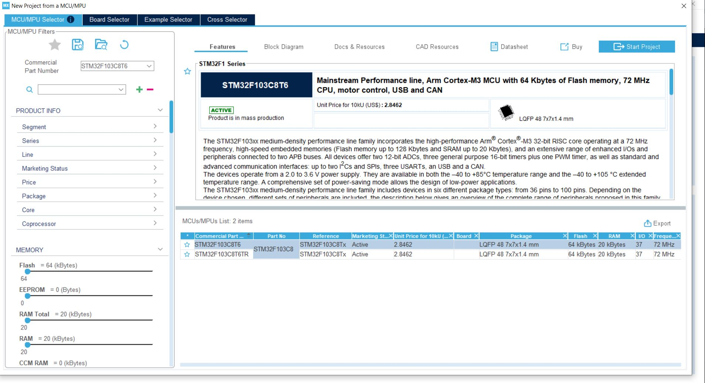
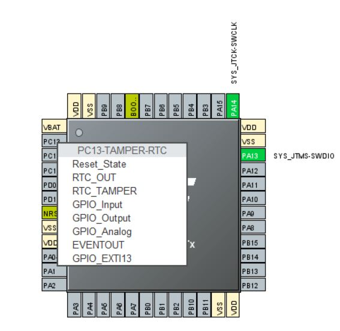
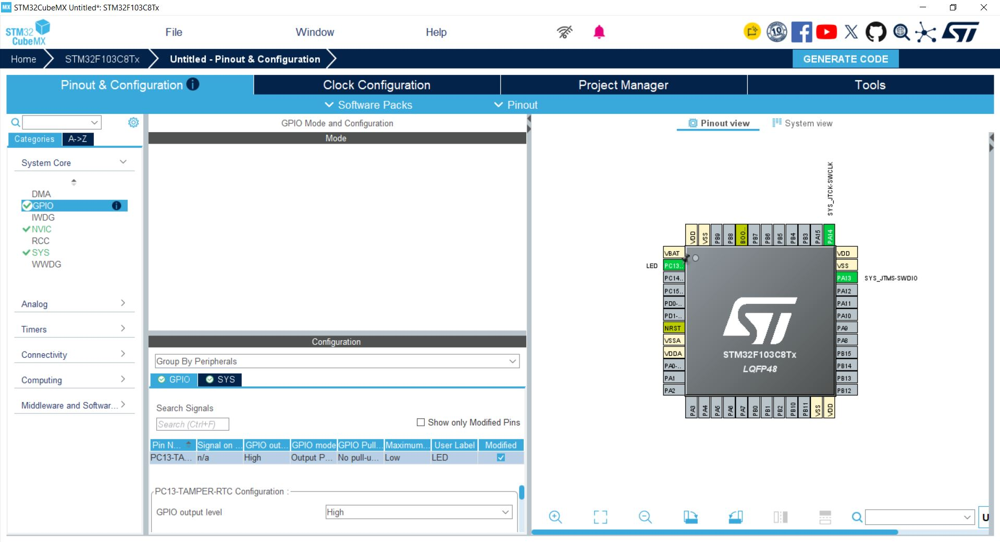
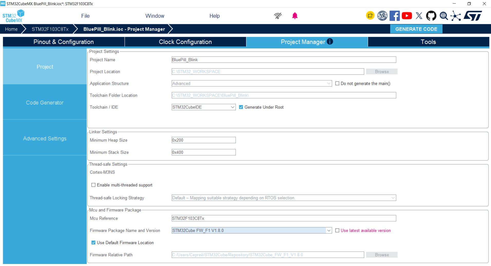
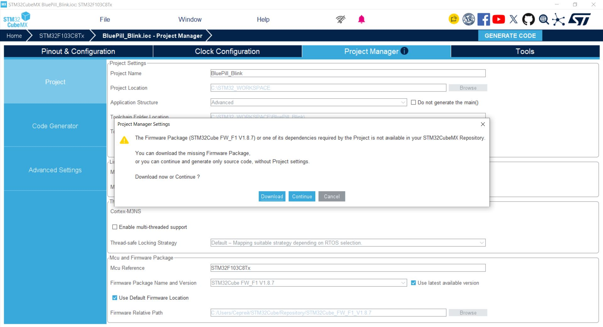
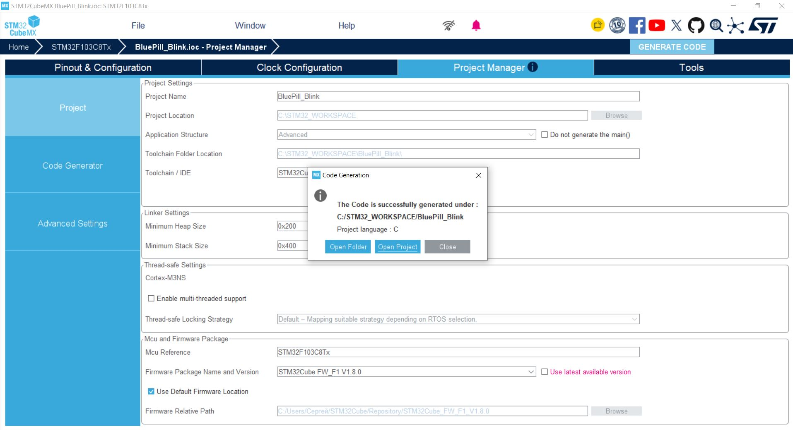
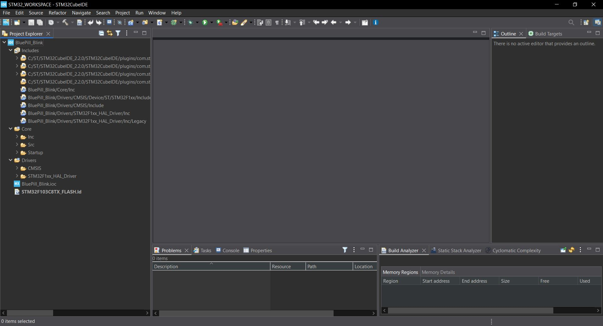
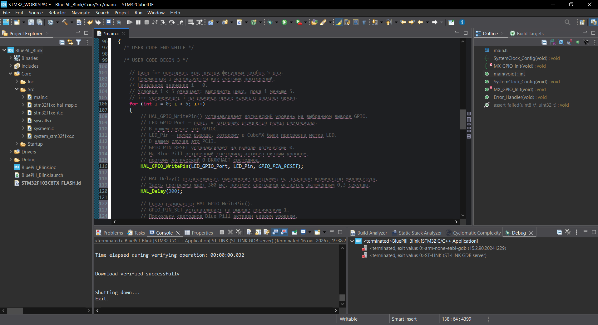
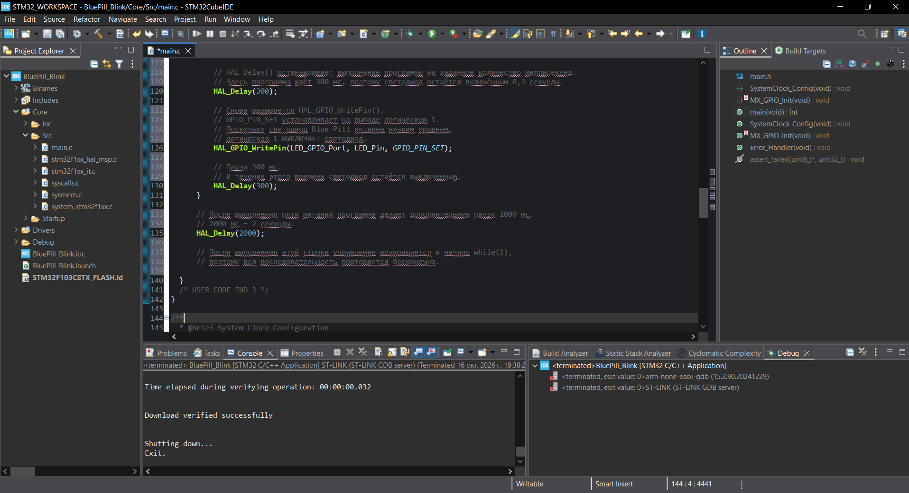
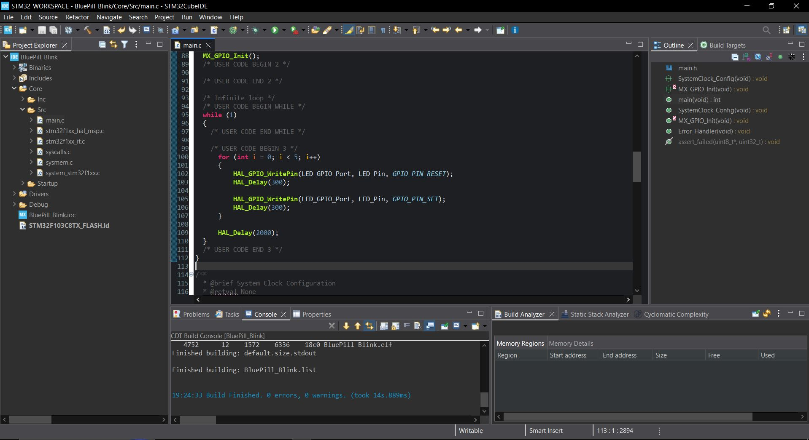

# Лабораторная работа №1 — GPIO Output: Blink

[← Подготовка рабочего места](../00-getting-started/README.md) | [↑ Карта курса](../README.md) | [Главная](../../README.md)

---

# Создание первого проекта STM32 и управление цифровым выходом GPIO

В этой лабораторной работе вы впервые пройдёте **полный цикл разработки программы для реального микроконтроллера STM32**:

```text
выбрать микроконтроллер
↓
настроить периферию
↓
сгенерировать проект
↓
написать программу
↓
собрать проект
↓
подключить программатор
↓
записать программу во Flash
↓
проверить результат на реальной плате
↓
самостоятельно изменить алгоритм
```

---

# 1. Цель работы

Научиться создавать простой проект для:

```text
STM32F103C8T6
```

и управлять цифровым выходом GPIO на примере встроенного светодиода платы Blue Pill.

В ходе работы необходимо:

- выбрать микроконтроллер в STM32CubeMX;
- включить интерфейс SWD;
- настроить PC13 как цифровой выход;
- создать проект STM32CubeIDE;
- познакомиться с базовой структурой проекта;
- написать программу с использованием HAL;
- выполнить Build;
- прошить микроконтроллер через ST-LINK V2;
- проверить работу программы;
- самостоятельно изменить алгоритм в соответствии со своим вариантом.

---

# 2. Что должно получиться

Сначала необходимо реализовать **базовый проверенный пример**.

Встроенный светодиод должен работать по алгоритму:

```text
LED ON  — 300 мс
LED OFF — 300 мс
```

Повторить:

```text
5 раз
```

После пяти миганий:

```text
пауза 2000 мс
```

После этого весь алгоритм повторяется.

Итог:

```text
5 миганий
↓
пауза 2 секунды
↓
5 миганий
↓
пауза 2 секунды
↓
...
```

После получения этого результата необходимо выполнить **самостоятельное задание по варианту**.

---

# 3. Что необходимо выполнить

Лабораторная работа состоит из двух частей.

## Часть А — работа по инструкции

Необходимо полностью повторить проверенный пример:

```text
5 миганий
300 мс ON
300 мс OFF
пауза 2000 мс
```

На этом этапе можно пользоваться всей инструкцией.

---

## Часть Б — самостоятельное задание

После того как базовый пример заработал, необходимо изменить программу в соответствии со своим вариантом.

На самостоятельном этапе необходимо уже самостоятельно определить:

- сколько раз выполнить цикл;
- какие задержки использовать;
- какие команды необходимо изменить;
- где расположить дополнительные задержки;
- соответствует ли фактическая работа заданному алгоритму.

При этом новые периферийные устройства и новые функции HAL не используются.

---

# 4. Что нужно знать перед началом

Перед выполнением лабораторной работы необходимо пройти:

➡️ **[00 — Подготовка рабочего места](../00-getting-started/README.md)**

Должны быть подготовлены:

- Blue Pill;
- STM32F103C8T6;
- ST-LINK V2;
- четыре провода Dupont;
- STM32CubeMX 6.18.1;
- STM32CubeIDE 2.2.0;
- STM32CubeF1 v1.8.0.

Если подготовительный этап не завершён, сначала вернитесь к разделу `00`.

---

# 5. Используемое оборудование

| Оборудование | Назначение |
|---|---|
| Blue Pill | Учебная плата |
| STM32F103C8T6 | Микроконтроллер |
| ST-LINK V2 | Программирование и отладка |
| 4 провода Dupont | Соединение SWD |
| USB-кабель | Подключение ST-LINK к ПК |
| ПК с Windows | Среда разработки |

Blue Pill:


ST-LINK V2:


---

# 6. Используемое программное обеспечение

Проверенная конфигурация:

| Компонент | Версия |
|---|---|
| STM32CubeMX | 6.18.1 |
| STM32CubeIDE | 2.2.0 |
| STM32CubeF1 | 1.8.0 |
| Библиотека | HAL |
| Интерфейс программирования | SWD |

---

# 7. Что необходимо понять перед программированием

Для первой работы достаточно пяти понятий:

```text
GPIO
PC13
active-low
HAL_GPIO_WritePin()
HAL_Delay()
```

Дополнительно понадобится простой цикл:

```c
for
```

и основной бесконечный цикл программы:

```c
while (1)
```

Ничего более сложного для выполнения этой работы не требуется.

---

# 8. Что такое GPIO

GPIO:

```text
General Purpose Input/Output
```

или:

```text
цифровой вход/выход общего назначения
```

Один и тот же вывод STM32 может использоваться в разных режимах.

Например:

```text
Input
Output
Alternate Function
Analog
```

В лабораторной работе используется:

```text
PC13 → GPIO_Output
```

То есть программа сможет устанавливать на выводе логическое состояние:

```text
0
```

или:

```text
1
```

---

# 9. Что означает PC13

Обозначение:

```text
PC13
```

означает:

```text
Port C
Pin 13
```

То есть это линия №13 порта C.

На используемой и проверенной Blue Pill встроенный пользовательский светодиод связан с:

```text
PC13
```

Поэтому внешний светодиод для первой работы не требуется.

---

# 10. Важно: PC13 и светодиод

PC13 является выводом **микроконтроллера**.

Светодиод — элемент **платы Blue Pill**.

Связь:

```text
PC13 → встроенный LED
```

является особенностью используемой платы.

Это важно отличать:

```text
микроконтроллер
≠
готовая плата
```

---

# 11. Что означает active-low

На проверенной Blue Pill встроенный LED работает по принципу:

```text
active-low
```

Поэтому:

```text
логический 0 → LED включён
логическая 1 → LED выключен
```

В HAL это соответствует:

```c
GPIO_PIN_RESET
```

→ светодиод включён.

```c
GPIO_PIN_SET
```

→ светодиод выключен.

Это может показаться обратным, но определяется электрической схемой платы.

---

# 12. Какие официальные документы относятся к работе

Первоисточниками являются официальные документы STMicroelectronics.

Для этой работы особенно относятся:

| Документ | Что связано с работой |
|---|---|
| DS5319 | STM32F103C8T6, выводы MCU |
| RM0008 | GPIO и RCC STM32F1 |
| UM1850 | HAL GPIO |
| AN2586 | Boot, питание, отладка |
| UM1075 | ST-LINK V2 и SWD |

Справочный раздел:

➡️ **[Документация и первоисточники](../../resources/references/README.md)**

Для выполнения ЛР №1 читать эти документы полностью не требуется.

Необходимый минимум объясняется непосредственно в этой лабораторной работе.

---

# 13. Запуск STM32CubeMX

Запустите:

```text
STM32CubeMX
```

На главной странице необходимо создать новый проект через:

```text
MCU Selector
```

---

# 14. Почему MCU Selector, а не Board Selector

Blue Pill является сторонней платой.

Она не относится к официальным платам ST типа:

```text
Nucleo
Discovery
```

Поэтому выбирается не готовая плата, а непосредственно микроконтроллер:

```text
STM32F103C8T6
```

---

# 15. Выбор STM32F103C8T6

В MCU Selector введите:

```text
STM32F103C8T6
```



Выберите:

```text
STM32F103C8T6
```

и создайте проект.

---

# 16. Основные параметры используемого MCU

Для текущей работы достаточно знать:

```text
MCU: STM32F103C8T6
Family: STM32F1
Core: Arm Cortex-M3
Flash: 64 KB
SRAM: 20 KB
Package: LQFP48
Maximum CPU frequency: 72 MHz
```

Для Blink специально настраивать максимальную частоту 72 MHz **не требуется**.

---

# 17. Настройка SWD

Откройте:

```text
System Core
→ SYS
```

В поле:

```text
Debug
```

выберите:

```text
Serial Wire
```


После этого STM32CubeMX резервирует:

```text
PA13 → SWDIO
PA14 → SWCLK
```

---

# 18. Что такое SWD

SWD:

```text
Serial Wire Debug
```

используется для:

- программирования STM32;
- запуска программы;
- отладки.

В первой работе программатор ST-LINK V2 будет взаимодействовать с STM32 именно через SWD.

---

# 19. Настройка PC13

На изображении корпуса найдите:

```text
PC13
```

Нажмите на него.

Выберите:

```text
GPIO_Output
```



---

# 20. Почему используется GPIO_Output

Программа должна самостоятельно управлять состоянием светодиода.

То есть STM32 должен **выдавать** логический уровень на PC13.

Следовательно:

```text
PC13 → Output
```

---

# 21. Пользовательская метка LED

Для PC13 задайте:

```text
User Label:
LED
```



После генерации проекта появятся определения:

```c
LED_GPIO_Port
LED_Pin
```

Это делает программу понятнее.

---

# 22. Начальное состояние GPIO

Установите:

```text
GPIO output level:
High
```

Для используемого active-low LED это соответствует:

```text
LED OFF
```

То есть после инициализации светодиод будет выключен.

---

# 23. Clock Configuration

Для лабораторной работы №1 специально изменять:

```text
Clock Configuration
```

не требуется.

Используется конфигурация, достаточная для выполнения простого Blink.

Настройка Clock Tree будет рассматриваться тогда, когда она понадобится для конкретной задачи.

---

# 24. Настройка проекта

Откройте:

```text
Project Manager
```

Укажите:

```text
Project Name:
BluePill_Blink
```

Рекомендуемая рабочая папка:

```text
C:\STM32_WORKSPACE
```

Toolchain / IDE:

```text
STM32CubeIDE
```

Используйте:

```text
Generate Under Root
```

---

# 25. Выбор STM32CubeF1 v1.8.0

Снимите:

```text
Use latest available version
```

и явно выберите:

```text
STM32Cube FW_F1 V1.8.0
```



---

# 26. Почему используется именно v1.8.0

Эта версия:

```text
STM32CubeF1 v1.8.0
```

была локально установлена и практически проверена в рамках курса.

Если оставить:

```text
Use latest available version
```

STM32CubeMX может попытаться скачать более новую версию через интернет.

Пример:



Для текущего курса это не требуется.

---

# 27. Генерация проекта

Нажмите:

```text
GENERATE CODE
```

После успешной генерации:



выберите:

```text
Open Project
```

Проект откроется в STM32CubeIDE.

---

# 28. Структура проекта

После открытия проекта в STM32CubeIDE появится:

```text
Project Explorer
```



Основные элементы:

```text
Core/
Drivers/
Startup/
BluePill_Blink.ioc
STM32F103C8TX_FLASH.ld
```

---

# 29. Файл `.ioc`

Файл:

```text
BluePill_Blink.ioc
```

содержит конфигурацию проекта STM32CubeMX.

В нём сохраняются, например:

- выбранный MCU;
- назначение выводов;
- настройки GPIO;
- настройки периферии;
- параметры генерации.

Не удаляйте этот файл.

---

# 30. Каталог Core

Основной пользовательский код находится в:

```text
Core/
```

Особенно важен файл:

```text
Core/Src/main.c
```

Именно его мы будем редактировать.

---

# 31. Каталог Drivers

В:

```text
Drivers/
```

находятся программные компоненты:

```text
CMSIS
STM32F1xx_HAL_Driver
```

Подробно разбирать все файлы пока не требуется.

---

# 32. Что такое HAL

HAL:

```text
Hardware Abstraction Layer
```

предоставляет готовые функции для управления периферией.

Например:

```c
HAL_GPIO_WritePin()
```

позволяет изменить логический уровень GPIO.

На первом этапе используем HAL, чтобы сосредоточиться на логике программы и взаимодействии с периферией.

---

# 33. USER CODE sections

В автоматически созданном `main.c` находятся области:

```c
/* USER CODE BEGIN ... */

/* USER CODE END ... */
```

Пользовательский код необходимо писать внутри этих областей.

Например:

```c
/* USER CODE BEGIN 3 */

/* ваш код */

/* USER CODE END 3 */
```

---

# 34. Почему USER CODE важен

STM32CubeMX может повторно сгенерировать проект.

При этом автоматически созданные части программы могут изменяться.

Код внутри:

```text
USER CODE
```

сохраняется.

Поэтому пользовательский код следует размещать именно там.

---

# 35. Найдите основной цикл

В:

```text
Core/Src/main.c
```

найдите:

```c
while (1)
{
    /* USER CODE END WHILE */

    /* USER CODE BEGIN 3 */

    /* USER CODE END 3 */
}
```

Код Blink будет размещён между:

```c
/* USER CODE BEGIN 3 */
```

и:

```c
/* USER CODE END 3 */
```

---

# 36. Базовая программа Blink

Введите:

```c
for (int i = 0; i < 5; i++)
{
    HAL_GPIO_WritePin(LED_GPIO_Port, LED_Pin, GPIO_PIN_RESET);
    HAL_Delay(300);

    HAL_GPIO_WritePin(LED_GPIO_Port, LED_Pin, GPIO_PIN_SET);
    HAL_Delay(300);
}

HAL_Delay(2000);
```

Пример:





---

# 37. Разберём программу по строкам

Начнём с:

```c
for (int i = 0; i < 5; i++)
```

Эта строка означает:

```text
выполнить код внутри цикла 5 раз
```

---

# 38. Как работает `for`

Цикл:

```c
for (int i = 0; i < 5; i++)
```

содержит три части.

## Начало

```c
int i = 0
```

Создаётся счётчик:

```text
i = 0
```

## Условие

```c
i < 5
```

Цикл выполняется, пока `i` меньше пяти.

## Изменение

```c
i++
```

После каждого выполнения:

```text
i = i + 1
```

Получаем:

```text
i = 0
i = 1
i = 2
i = 3
i = 4
```

То есть ровно:

```text
5 повторений
```

---

# 39. Включение LED

Команда:

```c
HAL_GPIO_WritePin(LED_GPIO_Port, LED_Pin, GPIO_PIN_RESET);
```

устанавливает на PC13:

```text
логический 0
```

Так как LED active-low:

```text
0 → LED ON
```

---

# 40. Первая задержка

```c
HAL_Delay(300);
```

означает:

```text
подождать 300 мс
```

или:

```text
0,3 секунды
```

В течение этого времени LED остаётся включённым.

---

# 41. Выключение LED

```c
HAL_GPIO_WritePin(LED_GPIO_Port, LED_Pin, GPIO_PIN_SET);
```

устанавливает:

```text
логическую 1
```

Для active-low:

```text
1 → LED OFF
```

---

# 42. Вторая задержка

```c
HAL_Delay(300);
```

оставляет LED выключенным ещё на:

```text
300 мс
```

После этого цикл `for` выполняется снова.

---

# 43. Пауза после пяти миганий

После завершения `for` выполняется:

```c
HAL_Delay(2000);
```

То есть:

```text
пауза 2 секунды
```

---

# 44. Почему алгоритм повторяется

Весь наш код находится внутри:

```c
while (1)
```

Это бесконечный цикл.

После:

```text
5 миганий
+
2 секунды паузы
```

программа возвращается в начало `while (1)`.

И последовательность выполняется снова.

---

# 45. Алгоритм программы

В более наглядном виде:

```text
START
↓
i = 0
↓
LED ON
↓
300 мс
↓
LED OFF
↓
300 мс
↓
i = i + 1
↓
i < 5 ?
├─ ДА → повторить мигание
└─ НЕТ
      ↓
   2000 мс
      ↓
   начало while(1)
```

---

# 46. Сохранение проекта

После изменения программы нажмите:

```text
Ctrl + S
```

---

# 47. Build

Выполните:

```text
Project
→ Build Project
```

или используйте кнопку Build на панели STM32CubeIDE.

IDE:

- компилирует файлы;
- проверяет синтаксис;
- выполняет линковку;
- формирует программу для микроконтроллера.

---

# 48. Проверенный результат Build

В проверенной конфигурации получено:

```text
Build Finished.
0 errors
0 warnings
```



---

# 49. Если есть ошибка

Не переходите к прошивке, пока:

```text
errors ≠ 0
```

Сначала:

1. найдите первое сообщение об ошибке;
2. определите строку;
3. сравните код с примером;
4. исправьте ошибку;
5. выполните Build повторно.

Цель:

```text
0 errors
```

---

# 50. Подключение ST-LINK

Перед подключением ST-LINK к USB соедините:

| ST-LINK V2 | Blue Pill |
|---|---|
| 3.3V | 3.3V |
| GND | GND |
| SWDIO | SWDIO |
| SWCLK | SWCLK |

Проверенная конфигурация:


---

# 51. Порядок подключения

1. Отключите ST-LINK от USB.
2. Найдите маркировку выводов.
3. Соедините GND.
4. Соедините 3.3V.
5. Соедините SWDIO.
6. Соедините SWCLK.
7. Проверьте все четыре соединения.
8. Подключите ST-LINK к USB.

---

# 52. Важно

У разных исполнений ST-LINK расположение выводов может отличаться.

Ориентируйтесь по:

```text
3.3V
GND
SWDIO
SWCLK
```

а не только по физическому расположению контактов.

Не соединяйте:

```text
5V → 3.3V
```

---

# 53. BOOT0

Для обычного запуска пользовательской программы используется:

```text
BOOT0 = 0
```

Если прошивка записалась, но программа после перезапуска не выполняется, проверьте положение BOOT0.

---

# 54. Прошивка программы

После успешного Build выполните:

```text
Run
→ Run As
→ STM32 C/C++ Application
```

STM32CubeIDE:

```text
подключится к ST-LINK
↓
подключится к STM32
↓
запишет программу
↓
проверит запись
↓
запустит программу
```

---

# 55. Run и Debug

Для первой лабораторной используется обычный:

```text
Run
```

Debug понадобится позднее для:

- breakpoint;
- пошагового выполнения;
- просмотра переменных;
- анализа состояния программы.

Для Blink отладка не обязательна.

---

# 56. Firmware ST-LINK

STM32CubeIDE может предложить обновить firmware ST-LINK.


Если программатор уже:

- определяется;
- подключается;
- прошивает MCU;

для текущей лабораторной обновление не требуется.

---

# 57. Проверка записи

После успешной прошивки в Console должно появиться:

```text
Download verified successfully
```


Это означает, что записанный образ программы был успешно проверен.

---

# 58. Проверка базового алгоритма

Наблюдайте за встроенным LED.

Должно получиться:

```text
ON  300 мс
OFF 300 мс
```

повторить:

```text
5 раз
```

затем:

```text
OFF 2000 мс
```

и повторить весь цикл.

---

# 59. Контрольная точка №1

Прежде чем выполнять самостоятельное задание, убедитесь:

- [ ] проект собирается;
- [ ] `0 errors`;
- [ ] программа прошивается;
- [ ] появляется `Download verified successfully`;
- [ ] LED мигает 5 раз;
- [ ] ON ≈ 300 мс;
- [ ] OFF ≈ 300 мс;
- [ ] после серии присутствует пауза ≈ 2 с;
- [ ] цикл повторяется.

Если это не выполнено — самостоятельную часть пока не начинайте.

---

# 60. Самостоятельное задание

Теперь необходимо изменить программу **самостоятельно**.

Разрешено использовать только уже изученные средства:

```c
HAL_GPIO_WritePin()
HAL_Delay()
for
while (1)
```

Не требуется:

- использовать таймеры;
- использовать прерывания;
- подключать кнопку;
- подключать внешний LED;
- добавлять новую периферию.

---

# 61. Как выполнять самостоятельную часть

Правильный порядок:

```text
прочитать свой вариант
↓
записать алгоритм словами
↓
определить количество повторений
↓
определить задержки
↓
изменить код
↓
Build
↓
Flash
↓
наблюдать результат
↓
сравнить результат с заданием
```

Не изменяйте код случайными значениями.

Перед программированием вы должны понимать, **какой результат ожидаете увидеть**.

---

# 62. Варианты самостоятельного задания

Номер варианта задаётся преподавателем.

Если преподавателем не установлен способ распределения вариантов, вариант выбирается по его указанию.

| Вариант | Задание |
|---:|---|
| 1 | 3 коротких мигания: ON 200 мс, OFF 200 мс; затем пауза 1500 мс |
| 2 | 4 мигания: ON 500 мс, OFF 250 мс; затем пауза 2000 мс |
| 3 | 6 быстрых миганий: ON 100 мс, OFF 100 мс; затем пауза 3000 мс |
| 4 | 2 медленных мигания: ON 1000 мс, OFF 500 мс; затем пауза 2000 мс |
| 5 | 5 миганий: ON 150 мс, OFF 450 мс; затем пауза 1500 мс |
| 6 | 7 миганий: ON 250 мс, OFF 250 мс; затем пауза 1000 мс |
| 7 | 3 мигания: ON 700 мс, OFF 300 мс; затем пауза 2500 мс |
| 8 | 8 быстрых миганий: ON 100 мс, OFF 200 мс; затем пауза 2000 мс |
| 9 | 4 мигания: ON 300 мс, OFF 700 мс; затем пауза 1000 мс |
| 10 | 6 миганий: ON 400 мс, OFF 400 мс; затем пауза 2500 мс |

---

# 63. Почему варианты отличаются

В каждом варианте изменяются три параметра:

```text
N
```

— количество миганий;

```text
tON
```

— длительность включения;

```text
tOFF
```

— длительность выключения;

а также:

```text
tPAUSE
```

— пауза между сериями.

Таким образом студент должен понять связь:

```text
параметры программы
↓
поведение реального устройства
```

---

# 64. Пример разбора задания

Например, если задано:

```text
3 мигания
ON 200 мс
OFF 200 мс
пауза 1500 мс
```

сначала нужно определить:

```text
N = 3
tON = 200
tOFF = 200
tPAUSE = 1500
```

После этого определить, **какие значения в базовой программе необходимо изменить**.

Готовый код для вариантов в методичке специально не приводится.

---

# 65. Дополнительное задание повышенной сложности

Если основной вариант выполнен быстро, можно попробовать создать последовательность:

```text
2 коротких мигания
↓
1 длинное мигание
↓
пауза
↓
повтор
```

Например:

```text
короткое:
ON 150 мс
OFF 150 мс

длинное:
ON 800 мс
OFF 300 мс

пауза:
2000 мс
```

Это задание необязательное.

Для его выполнения также достаточно уже изученных:

```c
HAL_GPIO_WritePin()
HAL_Delay()
for
```

Новая периферия не требуется.

---

# 66. Контрольная точка №2

Самостоятельная часть выполнена успешно, если:

- [ ] реализован именно назначенный вариант;
- [ ] проект собирается без ошибок;
- [ ] программа успешно прошивается;
- [ ] число миганий соответствует заданию;
- [ ] длительности визуально соответствуют заданным;
- [ ] присутствует заданная пауза;
- [ ] последовательность повторяется;
- [ ] студент может объяснить, какие строки программы были изменены и почему.

---

# 67. Контрольные вопросы

После выполнения работы ответьте на вопросы.

1. Какой микроконтроллер используется?
2. Почему для Blue Pill используется MCU Selector?
3. Для чего нужен STM32CubeMX?
4. Для чего нужен STM32CubeIDE?
5. Что такое GPIO?
6. Что означает PC13?
7. Почему PC13 используется как Output?
8. Что означает active-low?
9. Почему `GPIO_PIN_RESET` включает LED?
10. Для чего нужен ST-LINK V2?
11. Что такое SWD?
12. Какие выводы STM32 используются для SWD?
13. Зачем включается `Serial Wire`?
14. Что такое HAL?
15. Что делает `HAL_GPIO_WritePin()`?
16. Что делает `HAL_Delay()`?
17. Как работает цикл `for`?
18. Почему программа находится внутри `while (1)`?
19. Для чего нужны USER CODE sections?
20. Для чего нужен `.ioc`?
21. Что означает `0 errors`?
22. Что означает `Download verified successfully`?
23. Почему в проекте используется STM32CubeF1 v1.8.0?
24. Какие параметры пришлось изменить при выполнении самостоятельного варианта?
25. Как изменение этих параметров повлияло на работу реального LED?

---

# 68. Что необходимо включить в отчёт

Рекомендуемая структура отчёта:

## 1. Титульный лист

По требованиям образовательной организации.

---

## 2. Название работы

**Создание первого проекта STM32 и управление цифровым выходом GPIO.**

---

## 3. Цель работы

Кратко сформулировать цель.

---

## 4. Оборудование

Указать:

- Blue Pill;
- STM32F103C8T6;
- ST-LINK V2;
- соединительные провода;
- компьютер.

---

## 5. Программное обеспечение

Указать:

```text
STM32CubeMX 6.18.1
STM32CubeIDE 2.2.0
STM32CubeF1 v1.8.0
```

---

## 6. Схема подключения

Привести:

| ST-LINK V2 | Blue Pill |
|---|---|
| 3.3V | 3.3V |
| GND | GND |
| SWDIO | SWDIO |
| SWCLK | SWCLK |

---

## 7. Настройка STM32CubeMX

Показать:

- STM32F103C8T6;
- Serial Wire;
- PC13 → GPIO Output;
- User Label `LED`.

---

## 8. Базовый алгоритм

Привести:

```text
5 миганий
300 / 300 мс
↓
пауза 2000 мс
↓
повтор
```

---

## 9. Программный код базового примера

Привести пользовательский участок программы.

---

## 10. Результат Build

Привести фактический результат.

Для проверенного проекта:

```text
0 errors
0 warnings
```

---

## 11. Результат прошивки

Указать результат программирования.

Например:

```text
Download verified successfully
```

если он действительно был получен.

---

## 12. Результат базового эксперимента

Описать фактическое поведение LED.

---

## 13. Самостоятельное задание

Обязательно указать:

```text
Вариант №__
```

и привести полученное задание.

---

## 14. Алгоритм самостоятельного варианта

Перед кодом записать алгоритм словами.

Например:

```text
N = ...
tON = ...
tOFF = ...
tPAUSE = ...
```

---

## 15. Код самостоятельного варианта

Привести изменённый пользовательский участок программы.

---

## 16. Результат самостоятельного эксперимента

Описать:

- сколько миганий получилось;
- длительности;
- паузу;
- соответствует ли результат заданию.

---

## 17. Ответы на контрольные вопросы

По требованию преподавателя.

---

## 18. Вывод

В выводе необходимо указать:

- чему научились;
- какой GPIO был настроен;
- как выполнялось управление LED;
- как программа была записана в STM32;
- как изменение программных параметров повлияло на физическое поведение устройства.

---

# 69. Пример логики вывода

Не копируйте текст механически.

Пример структуры:

```text
В ходе лабораторной работы был создан проект для STM32F103C8T6
и настроен вывод PC13 в режиме GPIO Output.

Для управления встроенным светодиодом использовались функции HAL.
Проект был успешно собран и загружен в микроконтроллер
через ST-LINK V2 по интерфейсу SWD.

После проверки базовой программы был выполнен индивидуальный вариант,
в котором были изменены количество миганий и временные интервалы.

Практически подтверждена связь между параметрами программы
и поведением реального устройства.
```

Фактический вывод должен соответствовать реально выполненной работе.

---

# 70. Готовый проверенный проект

Исходный проект базовой части находится здесь:

➡️ **[BluePill_Blink](project/)**

Основной файл STM32CubeMX:

```text
project/BluePill_Blink.ioc
```

---

# 71. Как использовать готовый проект

Готовый проект предназначен для:

- проверки своей работы;
- сравнения конфигурации;
- восстановления проекта;
- изучения структуры.

Не рекомендуется начинать лабораторную работу с копирования готового проекта.

Сначала попробуйте пройти весь путь самостоятельно.

---

# 72. Критерии полного выполнения лабораторной работы

Работа считается завершённой, если выполнены обе части.

## Базовая часть

- [ ] создан проект STM32F103C8T6;
- [ ] настроен SWD;
- [ ] PC13 настроен как GPIO Output;
- [ ] создан проект STM32CubeIDE;
- [ ] написан базовый Blink;
- [ ] получено `0 errors`;
- [ ] выполнена прошивка;
- [ ] базовый алгоритм работает.

## Самостоятельная часть

- [ ] получен номер варианта;
- [ ] составлен алгоритм;
- [ ] программа изменена самостоятельно;
- [ ] выполнен Build;
- [ ] выполнена прошивка;
- [ ] результат соответствует варианту;
- [ ] студент может объяснить свои изменения.

---

# 73. Что студент должен уметь после работы

После лабораторной работы студент должен уметь:

- выбрать STM32F103C8T6;
- создать проект STM32CubeMX;
- включить SWD;
- настроить GPIO Output;
- объяснить назначение PC13;
- объяснить active-low;
- сгенерировать проект;
- найти `main.c`;
- использовать USER CODE sections;
- использовать `HAL_GPIO_WritePin()`;
- использовать `HAL_Delay()`;
- понимать простой `for`;
- понимать назначение `while (1)`;
- выполнить Build;
- подключить ST-LINK;
- прошить STM32;
- проверить результат;
- изменить простой алгоритм самостоятельно;
- объяснить связь между кодом и поведением реального устройства.

---

# 74. Лабораторная работа завершена

Если выполнены:

```text
базовый пример
+
самостоятельный вариант
+
проверка результата
+
объяснение программы
```

то лабораторная работа №1 завершена.

---

# Следующий шаг

Следующая лабораторная работа будет добавлена после согласования задания и практической проверки.

До этого рекомендуется:

- повторить создание проекта без инструкции;
- ещё раз объяснить себе работу `for`;
- попробовать изменить один параметр программы и заранее предсказать результат;
- подготовить отчёт по ЛР №1.

---

# Навигация

[← Подготовка рабочего места](../00-getting-started/README.md)

[↑ Карта курса](../README.md)

[← На главную](../../README.md)

**Лабораторная работа №2 будет добавлена после согласования**
