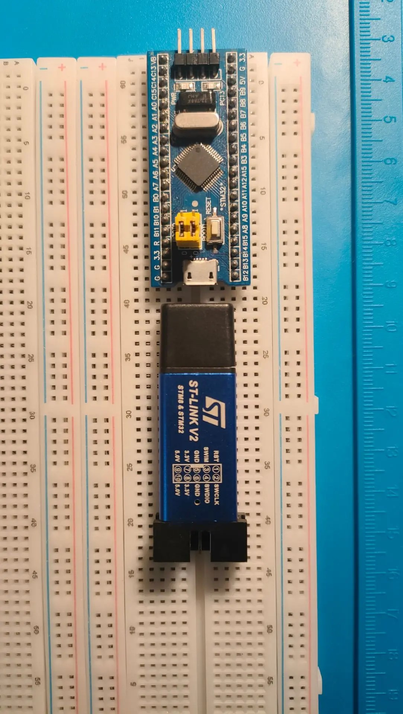
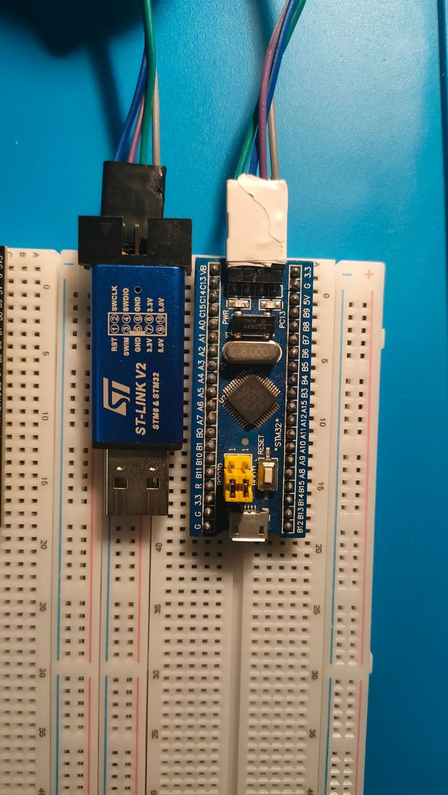
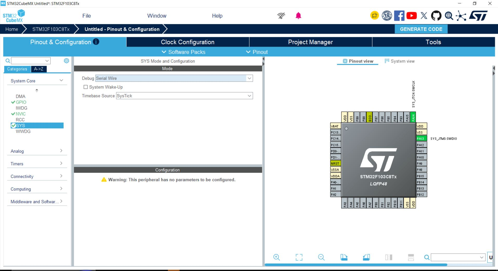
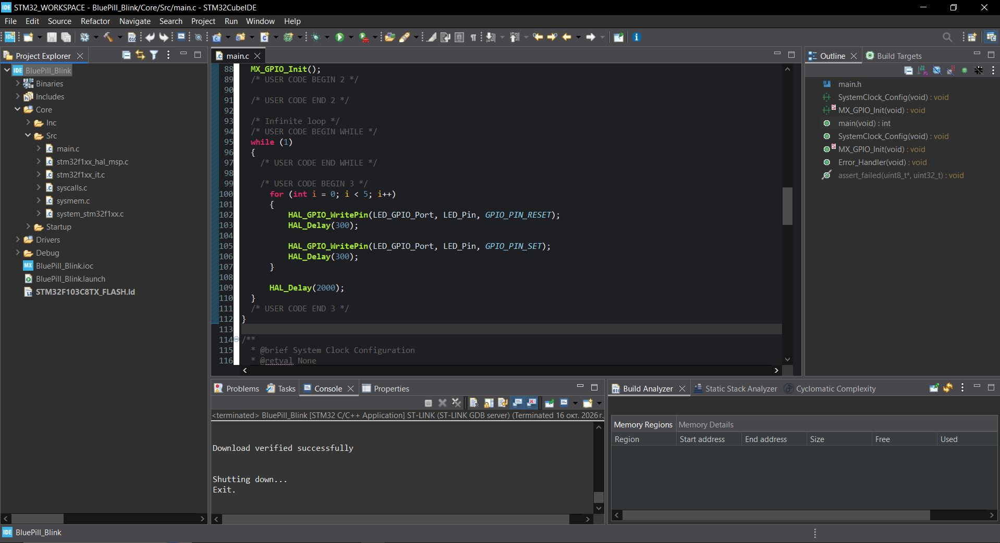
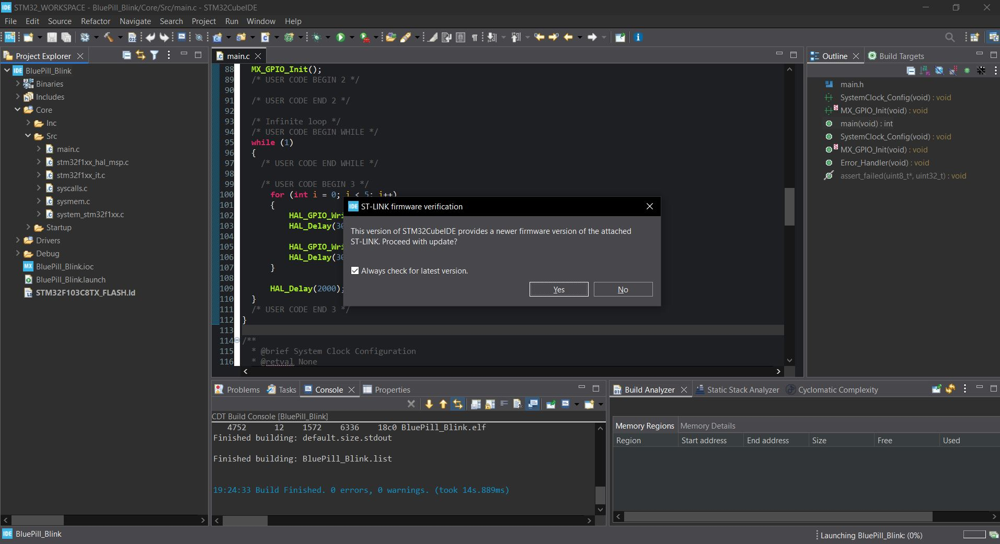

# ST-LINK V2 — подключение Blue Pill

[← Оборудование и закупка](../README.md) | [↑ Учебный курс](../../../course/README.md) | [Лабораторная работа №1 →](../../../course/01-blink/README.md)

---

# 1. Что такое ST-LINK V2

**ST-LINK V2** — программатор и отладчик для микроконтроллеров STM32.

В STM32 Start Lab он используется для связи компьютера с микроконтроллером:

```text
Компьютер
↓
USB
↓
ST-LINK V2
↓
SWD
↓
Blue Pill STM32F103C8T6
```

В первой лабораторной работе ST-LINK используется для:

- подключения к STM32F103C8T6;
- записи программы во Flash-память;
- запуска программы;
- проверки связи с микроконтроллером;
- дальнейшей отладки.

---

# 2. Используемый программатор

В проверенном учебном стенде используется распространённый вариант ST-LINK V2.



> У разных производителей и клонов ST-LINK внешний вид и расположение контактов могут отличаться.

Поэтому всегда ориентируйтесь по **подписям сигналов**, а не только по положению контакта на корпусе.

---

# 3. Какой интерфейс используется

Для Blue Pill используется интерфейс:

```text
SWD
```

Полное название:

```text
Serial Wire Debug
```

SWD позволяет выполнять программирование и отладку STM32 с небольшим количеством соединений.

Для первой лабораторной работы используются четыре линии:

```text
3.3V
GND
SWDIO
SWCLK
```

---

# 4. Подключение к Blue Pill

Используется следующая схема:

| ST-LINK V2 | Blue Pill | Назначение |
|---|---|---|
| 3.3V | 3.3V | Опорное питание/питание учебного стенда |
| GND | GND | Общая земля |
| SWDIO | SWDIO | Линия данных SWD |
| SWCLK | SWCLK | Тактовая линия SWD |

Проверенный вариант подключения:



---

# 5. SWDIO

```text
SWDIO
```

— линия передачи данных интерфейса SWD.

Она используется для обмена информацией между:

```text
ST-LINK
↔
STM32
```

В STM32F103 интерфейсу SWD соответствует вывод:

```text
PA13 → SWDIO
```

---

# 6. SWCLK

```text
SWCLK
```

— тактовая линия интерфейса SWD.

Она задаёт синхронизацию обмена между программатором и микроконтроллером.

В STM32F103:

```text
PA14 → SWCLK
```

---

# 7. GND

```text
GND
```

— общий электрический потенциал схемы.

ST-LINK и Blue Pill должны иметь общую землю.

Без соединения GND корректная связь между устройствами может отсутствовать.

---

# 8. 3.3V

В текущем учебном стенде используется:

```text
3.3V
```

При подключении необходимо внимательно проверить маркировку контактов.

## Важно

Не подключайте:

```text
5V
```

ST-LINK к контакту:

```text
3.3V
```

Blue Pill.

Перед подключением всегда проверяйте надписи на конкретном экземпляре программатора.

---

# 9. Порядок подключения

Для первой лабораторной работы используйте простой порядок.

## Шаг 1

Отключите ST-LINK от USB компьютера.

## Шаг 2

Найдите на ST-LINK:

```text
3.3V
GND
SWDIO
SWCLK
```

## Шаг 3

Найдите соответствующие контакты Blue Pill.

## Шаг 4

Соедините:

```text
ST-LINK 3.3V  → Blue Pill 3.3V
ST-LINK GND   → Blue Pill GND
ST-LINK SWDIO → Blue Pill SWDIO
ST-LINK SWCLK → Blue Pill SWCLK
```

## Шаг 5

Ещё раз визуально проверьте каждое соединение.

## Шаг 6

Только после проверки подключите ST-LINK к USB компьютера.

---

# 10. Почему сначала проверяем соединения

Ошибки подключения являются одной из наиболее частых причин, по которым начинающий студент получает сообщение о невозможности соединиться с микроконтроллером.

Поэтому используется принцип:

```text
сначала проверить соединение
↓
затем подключить питание
↓
затем искать программную проблему
```

Не следует сразу переустанавливать драйверы или STM32CubeIDE, если физическое подключение не проверено.

---

# 11. Настройка SWD в STM32CubeMX

В проекте откройте:

```text
System Core
→ SYS
```

В поле:

```text
Debug
```

выберите:

```text
Serial Wire
```



После этого STM32CubeMX резервирует:

```text
PA13 → SWDIO
PA14 → SWCLK
```

---

# 12. Зачем включать Serial Wire

Если выводы интерфейса отладки будут использоваться в проекте неправильно, работа программатора может быть нарушена.

Поэтому в учебных проектах SWD включается явно:

```text
Debug → Serial Wire
```

Это одновременно показывает студенту, какие выводы заняты интерфейсом программирования.

---

# 13. Драйвер ST-LINK

Для работы ST-LINK в Windows необходим драйвер.

В проверенной конфигурации драйвер устанавливался вместе с:

```text
STM32CubeIDE 2.2.0
```

При установке CubeIDE был включён компонент:

```text
ST-LINK drivers
```

Поэтому отдельная установка драйвера обычно не требуется.

---

# 14. Резервный пакет драйвера

В offline-комплекте предусмотрен файл:

```text
stsw-link009.zip
```

Он нужен как резервный вариант, если ST-LINK не определяется Windows.

Для первого запуска не устанавливайте дополнительный драйвер без необходимости.

Сначала проверьте, работает ли драйвер, установленный вместе с STM32CubeIDE.

---

# 15. Как понять, что ST-LINK работает

При успешной прошивке STM32CubeIDE устанавливает соединение с программатором и микроконтроллером.

После записи программы в консоли появляется:

```text
Download verified successfully
```



Это один из основных признаков того, что цепочка:

```text
CubeIDE
→ ST-LINK
→ SWD
→ STM32
```

работает.

---

# 16. Run и Debug

ST-LINK используется и в режиме:

```text
Run
```

и в режиме:

```text
Debug
```

## Run

Используется для:

- загрузки программы;
- запуска;
- обычной проверки результата.

## Debug

Позволяет дополнительно:

- устанавливать точки останова;
- выполнять программу пошагово;
- наблюдать переменные;
- анализировать выполнение программы.

Для первой лабораторной работы достаточно режима:

```text
Run
```

---

# 17. Firmware ST-LINK

STM32CubeIDE может предложить обновить firmware подключённого ST-LINK.

Пример:



В проверенной конфигурации обновление было отклонено, а программатор продолжил нормально работать.

---

# 18. Нужно ли обновлять firmware

Для первой лабораторной работы:

```text
если ST-LINK работает
→ обновление не требуется
```

Особенно это важно для недорогих совместимых ST-LINK неизвестного происхождения.

Не следует обновлять firmware только потому, что IDE предлагает более новую версию.

Сначала необходимо определить, есть ли реальная необходимость.

---

# 19. BOOT0

Для обычного запуска пользовательской программы из внутренней Flash-памяти Blue Pill используется:

```text
BOOT0 = 0
```

BOOT0 не является частью интерфейса ST-LINK, но его положение влияет на запуск программы после прошивки.

Если программа успешно записана, но после перезапуска не работает, BOOT0 является одним из пунктов проверки.

---

# 20. Если STM32CubeIDE не видит ST-LINK

Не меняйте сразу несколько параметров.

Проверяйте последовательно.

## Проверка 1. USB

Убедитесь, что:

- ST-LINK подключён к USB;
- кабель/разъём исправен;
- устройство получает питание.

## Проверка 2. Драйвер

Проверьте наличие драйвера ST-LINK.

Если STM32CubeIDE устанавливался с компонентом:

```text
ST-LINK drivers
```

драйвер уже должен присутствовать.

## Проверка 3. GND

Проверьте:

```text
GND → GND
```

## Проверка 4. SWDIO

Проверьте:

```text
SWDIO → SWDIO
```

## Проверка 5. SWCLK

Проверьте:

```text
SWCLK → SWCLK
```

## Проверка 6. 3.3V

Проверьте правильность линии питания/опорного напряжения.

## Проверка 7. Serial Wire

В STM32CubeMX должно быть:

```text
System Core
→ SYS
→ Debug
→ Serial Wire
```

---

# 21. Если ST-LINK определяется, но STM32 не прошивается

Тогда проблема может находиться уже между программатором и микроконтроллером.

Проверяйте:

```text
распиновку
↓
GND
↓
SWDIO
↓
SWCLK
↓
3.3V
↓
настройку SWD
↓
BOOT0
↓
конфигурацию запуска
```

Не следует сразу переустанавливать всю среду разработки.

---

# 22. STM32CubeProgrammer

Дополнительно для диагностики может использоваться:

```text
STM32CubeProgrammer
```

Он позволяет выполнять отдельные операции с микроконтроллером и ST-LINK.

Для лабораторной работы №1 STM32CubeProgrammer **не требуется**.

Он рассматривается как дополнительный диагностический инструмент.

---

# 23. Что студент должен знать о ST-LINK после ЛР №1

Не требуется знать всю внутреннюю архитектуру программатора.

Достаточно понимать:

```text
ST-LINK
↓
программатор/отладчик
```

```text
SWD
↓
интерфейс связи
```

```text
SWDIO
↓
данные
```

```text
SWCLK
↓
тактирование интерфейса
```

```text
GND
↓
общая земля
```

```text
3.3V
↓
уровень используемого учебного стенда
```

---

# 24. Проверочный список подключения

Перед прошивкой проверьте:

- [ ] ST-LINK отключался от USB во время первоначального соединения проводов;
- [ ] найден контакт 3.3V;
- [ ] найден контакт GND;
- [ ] найден SWDIO;
- [ ] найден SWCLK;
- [ ] 3.3V соединён с 3.3V;
- [ ] GND соединён с GND;
- [ ] SWDIO соединён с SWDIO;
- [ ] SWCLK соединён с SWCLK;
- [ ] в CubeMX включён Serial Wire;
- [ ] BOOT0 находится в положении 0;
- [ ] STM32CubeIDE установлен с ST-LINK drivers.

---

# 25. Связь с лабораторной работой №1

В первой лабораторной используется следующая цепочка:

```text
код программы
↓
Build
↓
Run
↓
ST-LINK V2
↓
SWD
↓
Flash STM32F103C8T6
↓
выполнение Blink
```

➡️ **[Перейти к лабораторной работе №1](../../../course/01-blink/README.md)**

---

# 26. Официальная документация

Для углублённого изучения используется официальное руководство STMicroelectronics:

```text
UM1075
ST-LINK/V2 in-circuit debugger/programmer
```

В рамках первой лабораторной работы читать документ полностью не требуется.

Необходимый минимум уже приведён в учебном курсе.

Справочник документов:

➡️ **[Официальная документация](../../references/README.md)**

---

# 27. Что запомнить

Для первой лабораторной достаточно:

```text
ST-LINK V2
    ↓
   SWD
    ↓
SWDIO + SWCLK
    ↓
STM32F103C8T6
```

и дополнительно:

```text
GND
3.3V
BOOT0 = 0
```

После проверки этой схемы переходите к лабораторной работе №1.

---

# Навигация

[← На главную](../../../README.md)

[↑ Карта учебного курса](../../../course/README.md)

[← Подготовка рабочего места](../../../course/00-getting-started/README.md)

➡️ **[Лабораторная работа №1 — Blink](../../../course/01-blink/README.md)**